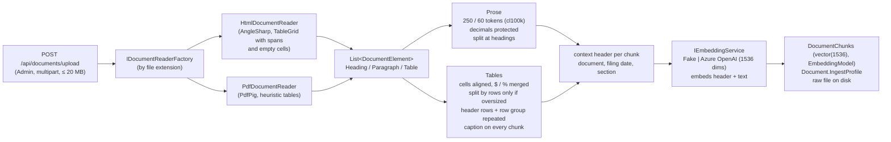
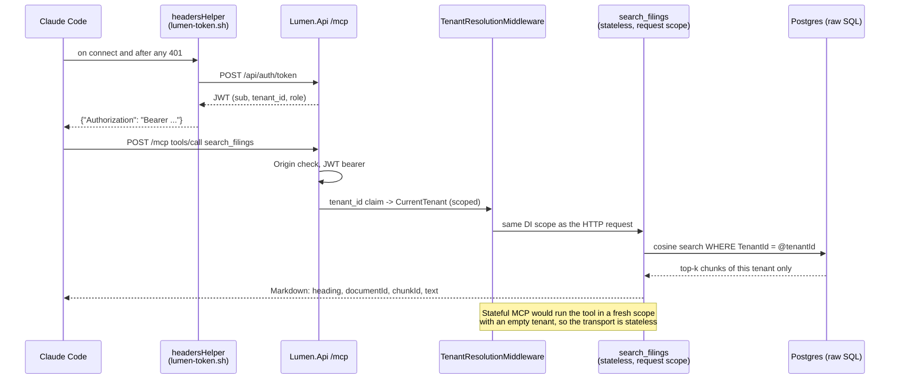
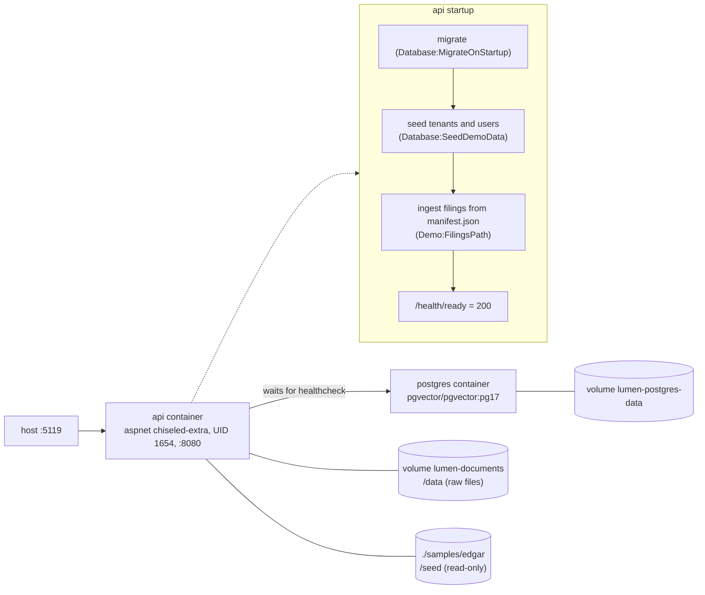

# Stage 7 (Polish) Implementation Plan

> **For agentic workers:** REQUIRED SUB-SKILL: Use superpowers:subagent-driven-development (recommended) or superpowers:executing-plans to implement this plan task-by-task. Steps use checkbox (`- [ ]`) syntax for tracking.

**Goal:** README, diagrams and DECISIONS.md that match the shipped system (through Stage 6B), plus a Swagger screenshot and an MCP demo GIF recorded by Claude, so a reader sees the product working within a minute.

**Architecture:** almost no product code. Text edits to `README.md`/`DECISIONS.md`/`CLAUDE.md`. Two reproducible media scripts under `tools/media/`:
- a Playwright script for the Swagger screenshot (against the compose API on :5119, Fake providers);
- a VHS tape for the GIF (Claude Code against a separate Azure-embedded API copy on :5219 with database `lumen_demo`).

Media land in `docs/media/`.

**Tech Stack:** Markdown + Mermaid (`@mermaid-js/mermaid-cli` for syntax checks), Playwright 1.63.0 (Node 24, Chromium), VHS (Homebrew), ffmpeg (frame extraction for review), Claude Code CLI.

**Spec:** `.research/stage-7/design.md` (decisions log: `.research/discussion/stage-7-kickoff.md`).

## Global Constraints

- **Never run `git commit`/`git push`** (CLAUDE.md). Every "commit" step in this plan is replaced by "leave in the working tree"; `git status` at the end shows the changes.
- README.md and DECISIONS.md are **English only**.
- DECISIONS.md: no placeholder or example entries; keep every entry's date, decision and numbers; chronological order.
- No product-code changes. The out-of-scope list from the spec stays out:
  - nginx replicas;
  - the `documentId` schema;
  - the "Morgan" rename.
- Media: `docs/media/mcp-demo.gif` (≈1000 px wide, ≤ ~30 s, ≤ 5 MB) and `docs/media/swagger.png`.
- The user's database `lumen` and the compose stack on :5119 must not be modified by the GIF setup. The demo uses database `lumen_demo`, port 5219 and storage root `App_Data/DemoDocuments` (gitignored via `App_Data/`).
- Numbers come from the sources named in each task. If a re-measured count (tests, isolation tests) differs from CLAUDE.md, the re-measured one wins.

## Review Focus

1. **Different eval sets mixed in one sentence.** The 6B numbers (41 questions, n = 35) must never be compared with the Stage 4 numbers (30 questions) as if they were one series. Every README line naming a percentage must say which set it is from. Check: Task 1 Step 6 greps.
2. **The GIF leaks the user's Russian CLAUDE.md or the wrong tenant.** If `--setting-sources project` is missing, answers come back in Russian. If the helper logs in as Globex, the trap shot shows nothing. Check: Task 5 Step 7 reads frames and checks for English text, the `22,429` answer and the refusal on the JPMorgan question.
3. **The demo setup touches the user's data.** A wrong connection string seeds Azure vectors into `lumen`, or a `docker compose down -v` deletes it. Check: Task 5 Step 2 records the document count in `lumen` before, and Step 9 re-checks it after.
4. **Mermaid that GitHub can't render.** Examples: `<` in labels, a `;` inside a sequence note, `end` as a node name. Check: Task 2 Step 5 renders every block with mermaid-cli.
5. **A broken relative image path in the README.** Check: Task 4 Step 5 and Task 5 Step 8 verify that the file exists at the path the README uses.

---

### Task 1: README brought up to Stage 6B (text only)

**Files:**
- Modify: `README.md` (sections: Results; What's interesting here; Ingestion bullets; Evaluation; Configuration; Implementation notes "Tests"; Roadmap)

**Interfaces:**
- Produces: final README section headings unchanged (`## Results`, `## What's interesting here`, `## Architecture`, `### Ingestion`, `## Evaluation`, `## API`, `## Configuration`, `## Roadmap`). Tasks 2, 4 and 5 insert into them.

- [ ] **Step 1: Re-measure the counts**

Run: `dotnet test 2>&1 | grep -E "Passed!|Failed!"` (Docker running; prefix `DOCKER_API_VERSION=1.43` if Testcontainers fails).
Expected: three `Passed!` lines; record unit / eval / integration totals.

Run:
```bash
grep -rl --include='*.cs' 'Isolation' tests/Lumen.IntegrationTests | xargs grep -cE '^\s*\[(Fact|Theory)' 
```
Expected: per-file test counts. Their sum is the isolation-test count, and the folders show the levels:
- EF Core (`Persistence`);
- HTTP (`Documents`, `DocumentTenantIsolationTests`);
- vector SQL;
- hybrid SQL;
- `/api/ask`;
- MCP;
- `Search`.

Use these numbers in Steps 3 and 5. If the sum is not 16, update the "16 isolation tests at 6 levels" bullet accordingly.

- [ ] **Step 2: Replace the Results section**

Replace everything from `## Results` up to (not including) `## What's interesting here` with:

```markdown
## Results

Measured on 4 real filings (Apple and JPMorgan, 10-K + 10-Q) with a question set written from the source documents before any tuning. Answers are generated by `gpt-4o`. Numbers are scored in code, prose answers are judged by `gpt-5-mini` (a different model family, so the model never grades itself).

**Current defaults** (`appsettings.json`), on the extended set: 41 questions, 35 scored, including 5 whose answer sits in the continuation of a split table:

| | Before table-aware chunking | Current defaults | |
|---|---|---|---|
| Answer accuracy | 77 % | **80 %** | |
| False answers (answered instead of refusing) | 0 % | **0 %** | includes unanswerable questions and cross-tenant traps |
| Retrieval hit@1 / hit@3 / hit@10 | 45 % / 52 % / 76 % | 48 % / **62 %** / 76 % | |
| Retrieval MRR | 0.524 | **0.565** | |

**How it got there.** On the original 30-question set, the Stage 4 retrieval and context work took accuracy from 70 % to 87 % (hit@10 75 % → 92 %, MRR 0.590 → 0.633, false answers 0 % throughout, answer latency p50 ~0.95 s). Stage 6B then extended the set with harder table questions, which is why its baseline (77 %) is lower than Stage 4's final number: the two sets are different and their percentages are not comparable.

Holdout set (6 questions, never used for tuning): 4/6, 0 false answers, both at the end of Stage 4 and on the current defaults. None of the gains is statistically significant on its own at this sample size (Stage 4: 7 gained / 2 lost, McNemar p = 0.18; Stage 6B: 2 gained / 1 lost, p = 1.0). The one step with a significant retrieval gain was a chunking bug fix (MRR p = 0.0085, see below). Raw runs are in [`tools/Lumen.Eval/runs/`](tools/Lumen.Eval/runs/).
```

- [ ] **Step 3: "What's interesting here": isolation count + one new bullet**

In the first bullet, set the isolation-test number and levels from Step 1.

After the "A one-regex fix beat every 'smart' change." bullet, insert:

```markdown
- **Split tables keep their header, and the measurement caught a bug the unit tests didn't.** EDGAR HTML never uses `<th>`/`<thead>`, so Lumen detects a table's header from its cell grid (columns aligned for 97.8–100 % of data tables in the four filings) and repeats it, plus the open row-group label and the table's caption, on every continuation chunk. That fixed the Stage 4 failure where a JPMorgan capital-ratio row arrived with no years and no "Standardized" label (accuracy 77 % → 80 %, hit@3 52 % → 62 %). The holdout then refused a question whose chunk had lost its caption: a first chunk over budget was being repacked without it. A log line counting repacks showed the scale (2 to 63 per filing); after the fix it is 0 on every filing.
```

- [ ] **Step 4: Ingestion bullets**

Replace the bullet starting `- **Tables are never cut mid-row.**` with:

```markdown
- **Tables are never cut mid-row, and their pieces stay readable.** Each table is its own chunk, split by rows only when it exceeds the token budget. Tables are rendered from their cell grid (`$` and `%` merged into the number, empty cells kept so columns don't shift). Every continuation chunk repeats the header rows and the open row-group label, and every chunk of a table carries the caption sentence from the paragraph above it.
```

In the bullet starting `- **Data remembers how it was written.**`, change the example profile to:

```
chunk=250/60;hdr=v1;merge=0;dec=v1;cells=v2;thdr=v2;tcap=v2
```

Check it against the live value: `curl -s localhost:5119/api/settings -H "Authorization: Bearer $TOKEN" | jq -r .ingestProfile` (or the equivalent property name in the response). Use the live string verbatim.

- [ ] **Step 5: Evaluation section**

1. Rename the sentence "Each change was measured on its own, one step at a time:" to "**Stage 4 ladder** (original 30-question set). Each change was measured on its own, one step at a time:".
2. After the Stage 4 table and before "A third mode, `agent`…", insert:

```markdown
**Stage 6B ladder** (extended 41-question set, 35 scored; not comparable with the table above). Each step adds one table switch on top of the Stage 4 final configuration:

| Step | Change | Accuracy | hit@3 | MRR | JPM 10-K / 10-Q chunks | Outcome |
|---|---|---|---|---|---|---|
| t0 | Stage 4 final (baseline) | 77 % | 52 % | 0.524 | 2,523 / 1,358 | |
| t1 | + Tables rendered from the cell grid | 71 % | 52 % | 0.511 | 2,494 / 1,328 | Kept as a prerequisite: 0:2, rank swaps between headerless tables |
| t2 | + Repeated header rows + captions | **80 %** | **62 %** | **0.565** | 2,596 / 1,444 | **Kept**: 3:0 vs t1, 2:1 vs t0 (p = 1.0) |
| t3 | + Key-value cell format | 77 % | 59 % | 0.561 | 3,166 / 2,280 | **Rejected**: 0:1, +58 % 10-Q chunks |
| t4 | t2 + context header in the prompt | 80 % | = t2 | 0.565 | = t2 | **Rejected**: 0:0, +~250 input tokens per question |
```

3. Replace the last paragraph of the section ("Retrieval columns come from… Known remaining gaps: …") with:

```markdown
Stage 4 retrieval columns come from `retrieval` runs (top 10); accuracy comes from `full` runs with 5 sources, except E4, E5 and Final with 10. All Stage 6B runs use 10 sources. Known remaining gaps: text tables whose first numeric row comes late get a wrong header, which is not repeated; tables whose header sits in a separate `<table>` above them get none; a one-row continuation with a long repeated header can drop out of the top 10; 10-K vs 10-Q comparisons need two chunks from two filings; and the sets are too small for significance.
```

- [ ] **Step 6: Configuration, tests, roadmap**

Configuration table: after the `Chunking:MergeBelowTokens` row insert:

```markdown
| `Chunking:TableCells` | `true` | render tables from their cell grid (merged `$`/`%`, empty cells kept) |
| `Chunking:TableHeaders` | `true` | repeat header rows and the row-group label on continuation chunks; requires `TableCells` |
| `Chunking:TableCaptions` | `true` | copy the caption sentence onto every chunk of a table |
| `Chunking:TableFormat` | `Pipe` | or `KeyValue` (`column: value` pairs); requires `TableCells` |
```

After the `Chat:Temperature` row insert:

```markdown
| `Chat:SourceContextHeader` | `false` | add the chunk's context header to each `<source>` in the `/api/ask` prompt |
```

Before the edit, verify each key and default in `src/Lumen.Api/appsettings.json` (`grep -n "Table\|SourceContextHeader" src/Lumen.Api/appsettings.json`).

Implementation notes, "Tests" bullet: use the totals from Step 1.

Roadmap: replace items 6 and 7 with:

```markdown
6. ✅ Run anywhere + tables: Dockerfile and `docker compose up` with health endpoints and seeded demo filings; table-aware chunking that repeats headers and captions. The real Azure App Service deploy was deliberately skipped (see "How I'd deploy to Azure")
7. ✅ Polish: demo GIF, Swagger screenshot, diagrams, DECISIONS.md pass
```

Verify:
```bash
grep -n "87 %\|80 %\|77 %\|70 %" README.md
```
Expected: every hit is either inside a clearly labelled Stage 4 / original-set context or a Stage 6B / extended-set context (Review Focus 1). Read each hit's paragraph.

- [ ] **Step 7: Leave in working tree** (no commit).

---

### Task 2: Mermaid diagrams

**Files:**
- Modify: `README.md` (`### Ingestion` diagram; new `### MCP request flow` after `### Question answering`; new diagram in `### Run with Docker`)
- Create (scratch only): `$SCRATCH/mermaid/*.mmd` — not in the repo

**Interfaces:**
- Consumes: the README layout after Task 1.

- [ ] **Step 1: Confirm the facts the diagrams state**

Run:
```bash
grep -n "UseMiddleware\|MapMcp\|UseAuthentication\|UseAuthorization\|McpOrigin\|TenantResolution" src/Lumen.Api/Program.cs src/Lumen.Api/Extensions/*.cs
```
Expected: the order of the Origin middleware, authentication, tenant resolution and `MapMcp().RequireAuthorization()`. The MCP sequence diagram in Step 3 must follow that order. If it differs, reorder the participants and messages to match.

Run:
```bash
grep -rn "SessionMode\|Stateless" src/Lumen.Api
```
Expected: stateless confirmed.

- [ ] **Step 2: Replace the Ingestion diagram**

````markdown

````

- [ ] **Step 3: Add the MCP request flow section**

After the `### Question answering` section's closing paragraph, insert:

````markdown
### MCP request flow


````

- [ ] **Step 4: Add the Docker diagram**

In `### Run with Docker`, directly after the `docker compose up --build` code block, insert:

````markdown

````

Before inserting, confirm the volume names and mounts against `docker-compose.yml`.

- [ ] **Step 5: Render every Mermaid block**

```bash
SCRATCH=<scratchpad>/mermaid; mkdir -p "$SCRATCH"
awk '/^```mermaid/{f=1;n++;next} /^```/{if(f){f=0};next} f{print > (dir "/block" n ".mmd")}' dir="$SCRATCH" README.md
for f in "$SCRATCH"/*.mmd; do npx -y @mermaid-js/mermaid-cli@11.4.2 -i "$f" -o "${f%.mmd}.svg" || echo "FAIL $f"; done
```
Expected: one `.svg` per block, no `FAIL` lines (8 blocks: architecture, multi-tenancy, ingestion, question answering, MCP flow, data model, Docker, plus any others present). Open 2–3 SVGs with Read to sanity-check the layout.

- [ ] **Step 6: Leave in working tree.**

---

### Task 3: DECISIONS.md medium pass

**Files:**
- Modify: `DECISIONS.md`

- [ ] **Step 1: Snapshot the numbers**

```bash
grep -oE '[0-9]+([.,][0-9]+)?' DECISIONS.md | sort | uniq -c | sort -k2 > <scratchpad>/decisions-numbers-before.txt
```

- [ ] **Step 2: Add the index**

Directly after the template block's closing comment line (`<!-- Entries go below… -->`), insert an `## Index` section. One line per entry, grouped by stage, each linking to the entry heading's GitHub anchor (lowercase, spaces → `-`, punctuation dropped; verify every anchor by rendering or by inspection):

```markdown
## Index

**Before Stage 1 / Stage 1 — skeleton**
- [PostgreSQL + pgvector instead of SQL Server 2025](#…) — ANN index GA vs preview; native arm64 image
- [One legal `.IgnoreQueryFilters()`](#…) — 1 call site, 2 independent isolation tests

**Stage 2 — ingest & chunking**
- [Atomic table chunks, prose at 250/60 tokens](#…) — 29 % of chunks are tables a fixed splitter would cut

**Stage 3 — embeddings & search**
- [Azure OpenAI via the plain `OpenAI` package and the v1 API](#…) — avoids 12 minor versions of assembly skew
- [Vector search as raw SQL with an explicit tenant predicate](#…) — negative control shows the table leaks without it

**Stage 4 — RAG & eval-driven tuning**
- [`gpt-4o` answers, `gpt-5-mini` judges](#…) — chosen by quota (0 TPM on newer models)
- [Ingest profile stored on every document](#…) — a mixed corpus had cost 19 points of hit@5
- [Per-document chunk cap off](#…) — accuracy 70 % → 63 %, MRR p = 0.033 worse
- [10 sources instead of 5](#…) — accuracy 70 % → 83 %, 4:0 flips
- [Hybrid search off](#…) — 3:3 flips, p = 1.0
- [Short-chunk merging off](#…) — 1:1 flips
- [Context headers on](#…) — hit@10 67 % → 92 %
- [Decimal-safe chunking on](#…) — the only significant gain, MRR p = 0.0085
- [Temperature 0.2 is not a lever](#…) — 87 % at 0, 0.2 and 0.6
- [Prompt and exact search left alone](#…) — 0 % false answers in 15 runs; ~300 ms search

**Stage 5 — MCP**
- [Stateless transport, required for isolation](#…) — stateful saw an empty tenant
- [Search-only tools, no `ask`](#…) — 87 % = 87 %, at ~9× cost
- [`get_chunk_context` off](#…) — 0 calls in 30 questions
- [Existing JWT + token helper, not OAuth](#…) — 0 new auth code; 401 → helper → retry verified
- [Isolated agent eval](#…) — 40 % → 87 % once the user's settings were kept out

**Stage 6 — run anywhere & tables**
- [Split tables keep header, row group and caption](#…) — accuracy 77 % → 80 %, hit@3 52 % → 62 %
- [Key-value table format off](#…) — 0:1, +58 % chunks
- [No context header in the `/api/ask` prompt](#…) — 0:0
- [`aspnet:10.0-noble-chiseled-extra`, non-root](#…) — 202 MB vs 294 MB
- [Migrate and seed at startup behind flags](#…) — cold start 7.5 s, warm 1.2 s
```

Replace every `#…` with the real anchor of that entry's heading. Recount the numbers against each entry's own Why paragraph. The index must not introduce a number the entry doesn't contain. In particular, check "19 points of hit@5" (52 % → 71 %) against the 2026-10-06 entry; if the entry doesn't state it in that form, write "hit@5 52 % → 71 %" instead.

- [ ] **Step 3: Remove the duplicate sentence**

The sentence beginning "Confirmed by a control run of the final configuration (vector + headers + whole decimals, contextTopK=10): accuracy 87 % without hybrid and merging vs 83 % with them (E4)…" appears in both the 2026-10-07 hybrid entry and the merge entry:
- keep it in the hybrid entry;
- in the merge entry, replace it with: "The same control run as in the hybrid entry (87 % without hybrid and merging vs 83 % with them) confirms it."

- [ ] **Step 4: Fix stale forward references**

```bash
grep -n "Stage 6" DECISIONS.md
```
For each hit inside a 2026-09-* / 2026-10-0* / 2026-10-11 entry that speaks of Stage 6 as a planned Azure deploy, change it as follows:
- "(e.g. Azure SQL Database instead of Azure Database for PostgreSQL in Stage 6)" → "(e.g. Azure SQL Database instead of Azure Database for PostgreSQL in a real Azure deploy)";
- "a ready base for managed identity in Stage 6" → "a ready base for managed identity in a real Azure deploy";
- "Stateless also needs no sticky sessions on App Service (Stage 6)." → "Stateless also needs no sticky sessions behind a load balancer.";
- "real users have to connect (Stage 6 or later)" → "real users have to connect".

Leave references to Stage 6 as the stage that actually happened (6A/6B entries) unchanged.

- [ ] **Step 5: Mark grown counts as historical**

In the 2026-09-20 vector-search entry, "There are now 11 of them in 8 classes at five levels" → "At the time there were 11 of them in 8 classes at five levels (Stage 5 added MCP-level tests; see the README for the current count)".

In the 2026-09-10 entry, keep "23/23" (it is explicitly the Stage 1 run).

- [ ] **Step 6: Tighten the longest Why paragraphs**

Targets (longest first), all without dropping a number from the Step 1 snapshot:
- 2026-10-06 (ingest profile);
- 2026-10-12 split tables;
- 2026-10-07 context headers;
- 2026-09-10;
- 2026-09-09.

Rules:
- lead with the decisive number;
- keep the mechanism sentence;
- move parenthetical asides to the end or drop them only if they carry no number;
- don't change meaning.

- [ ] **Step 7: Verify no number was lost**

```bash
grep -oE '[0-9]+([.,][0-9]+)?' DECISIONS.md | sort | uniq -c | sort -k2 > <scratchpad>/decisions-numbers-after.txt
diff <scratchpad>/decisions-numbers-before.txt <scratchpad>/decisions-numbers-after.txt
```
Expected: differences only from the added index (higher counts), the "at the time" edit and the merged duplicate sentence (lower counts of 87/83/56.8/65.6/948/1,414 by exactly 1). Any number whose count dropped to 0 is a defect: restore it.

Check anchors: `grep -o '](#[^)]*)' DECISIONS.md` versus the headings transformed to anchors. Every link must resolve.

- [ ] **Step 8: Leave in working tree.**

---

### Task 4: Swagger screenshot

**Files:**
- Create: `tools/media/package.json`, `tools/media/swagger-screenshot.mjs`
- Create: `docs/media/swagger.png`
- Modify: `.gitignore` (add `tools/media/node_modules/`), `README.md` (`## API`)

**Interfaces:**
- Consumes: the compose API at `http://localhost:5119` (already running; Fake providers, Swagger enabled, seeded).
- Produces: `docs/media/swagger.png`.

- [ ] **Step 1: Check that the API is up**

```bash
curl -fsS localhost:5119/health/ready && curl -fsS -o /dev/null -w '%{http_code}\n' localhost:5119/swagger/index.html
```
Expected: ready, then `200`. If it is not up: `docker compose up -d` (needs `.env` with `JWT_SECRET`).

- [ ] **Step 2: Create the tool**

`tools/media/package.json`:
```json
{
  "name": "lumen-media",
  "private": true,
  "type": "module",
  "devDependencies": { "playwright": "1.63.0" }
}
```

`tools/media/swagger-screenshot.mjs`:
```js
import { chromium } from 'playwright';

const base = process.env.LUMEN_URL ?? 'http://localhost:5119';
const out = process.argv[2] ?? 'docs/media/swagger.png';

const res = await fetch(`${base}/api/auth/token`, {
  method: 'POST',
  headers: { 'Content-Type': 'application/json' },
  body: JSON.stringify({ email: 'admin@acme.test', password: 'Passw0rd!' }),
});
if (!res.ok) throw new Error(`login failed: ${res.status}`);
const { token } = await res.json();

const browser = await chromium.launch();
const page = await browser.newPage({ viewport: { width: 1280, height: 1600 }, deviceScaleFactor: 2 });
await page.goto(`${base}/swagger/index.html`);
await page.locator('.opblock').first().waitFor();

await page.locator('button.authorize').first().click();
await page.locator('.modal-ux input[type=text]').fill(token);
await page.locator('.modal-ux button.authorize').click();
await page.locator('.modal-ux button.btn-done').click();

const ask = page.locator('.opblock-post', { has: page.locator('.opblock-summary-path', { hasText: /^\/api\/ask$/ }) });
await ask.locator('.opblock-summary').click();
await ask.locator('button.try-out__btn').click();
await ask.locator('textarea.body-param__text').fill(JSON.stringify(
  { question: 'How many shareholders of record did Apple have as of October 17, 2025?' }, null, 2));
await ask.locator('button.execute').click();
await ask.locator('.live-responses-table .response-col_status').first().waitFor();

await page.screenshot({ path: out, fullPage: true });
await browser.close();
console.log(`saved ${out}`);
```

`.gitignore`: add under the "Eval harness" block:
```
# Media tooling dependencies
tools/media/node_modules/
```

- [ ] **Step 3: Run it**

```bash
cd tools/media && npm install && npx playwright install chromium && cd ../.. && mkdir -p docs/media && node tools/media/swagger-screenshot.mjs docs/media/swagger.png
```
Expected: `saved docs/media/swagger.png`.

If a selector times out, the Swashbuckle UI version uses different class names. Open the page with `page.content()` dumped to scratch, find the right selector, fix the script, and rerun. Do not skip the Authorize step: an unauthorized Execute gives a 401 in the screenshot.

- [ ] **Step 4: Inspect and crop**

Read `docs/media/swagger.png`. Expected:
- the Authorize lock is closed;
- every controller's endpoints are visible;
- `/api/ask` is expanded with a `200` response body showing `answer`, `sources` and `refused`.

If the full page is too tall (> ~3000 px at 2×), crop it to the region from the top through the `/api/ask` response with ffmpeg:
```bash
ffmpeg -y -i docs/media/swagger.png -vf "crop=iw:<height>:0:0" docs/media/swagger-cropped.png && mv docs/media/swagger-cropped.png docs/media/swagger.png
```
Keep the file ≤ ~1.5 MB. If larger, re-run with `deviceScaleFactor: 1.5`.

- [ ] **Step 5: Embed in README**

Directly under `## API`, before the table:
```markdown


The screenshot is taken with the default `Fake` providers, so the answer is a canned one; it shows the API surface, not answer quality.
```
Verify: `test -f docs/media/swagger.png && grep -n "docs/media/swagger.png" README.md`.

- [ ] **Step 6: Leave in working tree.**

---

### Task 5: MCP demo GIF

**Files:**
- Create: `tools/media/demo-server.sh`, `tools/media/mcp-demo.tape`, `tools/media/mcp-demo/.mcp.json.template`
- Create: `docs/media/mcp-demo.gif`
- Modify: `README.md` (under the intro)

**Interfaces:**
- Consumes: `tools/mcp/lumen-token.sh` (env `LUMEN_URL`, `LUMEN_EMAIL`, `LUMEN_PASSWORD`; prints `{"Authorization":"Bearer …"}`); the user's Azure user-secrets on `Lumen.Api`; local Postgres on 5432.
- Produces: `docs/media/mcp-demo.gif`; an API on `http://localhost:5219` backed by database `lumen_demo`.

- [ ] **Step 1: Install VHS**

`brew install vhs` (pulls `ttyd`; `ffmpeg` is already present). Verify: `vhs --version`.

- [ ] **Step 2: Record the user's data baseline**

```bash
docker exec dotnet-mcp-rag-server-postgres-1 psql -U postgres -d lumen -tAc 'select count(*) from "Documents"; select count(*) from "DocumentChunks";'
```
Save both numbers to `<scratchpad>/lumen-baseline.txt`.

- [ ] **Step 3: Create the demo-server script**

`tools/media/demo-server.sh`:
```bash
#!/usr/bin/env bash
# Starts a separate Lumen API for recording the MCP demo: port 5219, database lumen_demo,
# Azure providers from the user-secrets of src/Lumen.Api. The regular `lumen` database is never touched.
set -euo pipefail
cd "$(dirname "$0")/../.."

export ASPNETCORE_ENVIRONMENT=Development
export ASPNETCORE_URLS=http://localhost:5219
export ConnectionStrings__Default="Host=localhost;Port=5432;Database=lumen_demo;Username=postgres;Password=postgres"
export Demo__FilingsPath="$PWD/samples/edgar"
export DocumentStorage__RootPath="$PWD/src/Lumen.Api/App_Data/DemoDocuments"

exec dotnet run --project src/Lumen.Api --no-launch-profile
```
`chmod +x tools/media/demo-server.sh`.

`--no-launch-profile` keeps `launchSettings.json` from overriding `ASPNETCORE_URLS`. The environment is still Development, so user-secrets load.

- [ ] **Step 4: Start it and wait for seeding**

Run `tools/media/demo-server.sh` in the background (log to `<scratchpad>/demo-server.log`), then poll:
```bash
until curl -fsS localhost:5219/health/ready >/dev/null; do sleep 5; done
```
Verify that Azure is in use and the corpus is complete:
```bash
T=$(LUMEN_URL=http://localhost:5219 LUMEN_EMAIL=admin@acme.test LUMEN_PASSWORD='Passw0rd!' tools/mcp/lumen-token.sh | jq -r .Authorization)
curl -s localhost:5219/api/settings -H "Authorization: $T" | jq '.embeddings, .chat'
curl -s localhost:5219/api/documents -H "Authorization: $T" | jq -r '.[] | "\(.title) \(.ingestProfile)"'
curl -s -X POST localhost:5219/api/ask -H "Authorization: $T" -H 'Content-Type: application/json' \
  -d '{"question":"How many shareholders of record did Apple have as of October 17, 2025?"}' | jq -r .answer
```
Expected:
- embeddings `AzureOpenAI` / `text-embedding-3-small`, chat `gpt-4o`;
- Apple 10-K and Apple 10-Q listed for Acme;
- the answer contains `22,429`.

If seeding fails on Azure quota (429), wait and restart the script: already-ingested titles are skipped.

- [ ] **Step 5: Prepare the client directory**

`tools/media/mcp-demo/.mcp.json.template`:
```json
{
  "mcpServers": {
    "lumen": {
      "type": "http",
      "url": "http://localhost:5219/mcp",
      "headersHelper": "LUMEN_URL=http://localhost:5219 LUMEN_EMAIL=admin@acme.test LUMEN_PASSWORD='Passw0rd!' __REPO__/tools/mcp/lumen-token.sh"
    }
  }
}
```
Build the working dir outside the repo:
```bash
DEMO=<scratchpad>/mcp-demo; mkdir -p "$DEMO"
sed "s#__REPO__#$PWD#" tools/media/mcp-demo/.mcp.json.template > "$DEMO/.mcp.json"
```
Smoke-test without recording:
```bash
cd "$DEMO" && claude -p "Use the lumen tools. How many shareholders of record did Apple have as of October 17, 2025? Answer in English." \
  --mcp-config .mcp.json --strict-mcp-config --setting-sources project --tools "" --allowedTools "mcp__lumen__*"
```
Expected: an English answer containing `22,429`. If the helper doesn't run because the folder isn't trusted, use the same flags the eval harness's agent mode uses (`tools/Lumen.Eval`, grep `setting-sources`) and mirror them here.

- [ ] **Step 6: Write the tape and record**

`tools/media/mcp-demo.tape` (paths come from env, set when invoking):
```
Output docs/media/mcp-demo.gif
Require claude

Set Shell "bash"
Set FontSize 15
Set Width 1000
Set Height 640
Set Padding 16
Set Theme "Catppuccin Mocha"
Set TypingSpeed 35ms
Set Framerate 12
Set PlaybackSpeed 1.0

Hide
Type `cd "$DEMO" && clear && claude --mcp-config .mcp.json --strict-mcp-config --setting-sources project --tools "" --allowedTools "mcp__lumen__*"`
Enter
Sleep 8s
Show

Type "/mcp"
Sleep 500ms
Enter
Sleep 3s
Escape
Sleep 1s

Type "How many shareholders of record did Apple have as of October 17, 2025?"
Enter
Sleep 25s

Type "What was JPMorgan Chase's CET1 capital ratio at June 30, 2026?"
Enter
Sleep 25s
```
Run: `DEMO=<scratchpad>/mcp-demo vhs tools/media/mcp-demo.tape`.

If the trust prompt or a first-run dialog appears in the hidden part, add `Enter` + `Sleep 2s` after `Sleep 8s` inside `Hide` and re-record. If the TUI renders garbled under VHS after two attempts, switch to the fallback: replace the interactive `claude …` line with `claude -p "<question>" … --output-format text` per question, preceded by an `echo "> <question>"`, and drop the `/mcp` shot in favour of `claude mcp list`-style output from `jq . .mcp.json`.

- [ ] **Step 7: Review frames**

```bash
mkdir -p <scratchpad>/frames && ffmpeg -y -i docs/media/mcp-demo.gif -vf "fps=1/3" <scratchpad>/frames/f%02d.png
ls -la docs/media/mcp-demo.gif
```
Read the frames as images. Required:
- (a) `/mcp` shows `lumen` connected;
- (b) a `search_filings` tool call is visible;
- (c) the first answer contains `22,429`;
- (d) the JPMorgan question ends in a refusal or "not in the filings", with no JPMorgan figure;
- (e) all text is English;
- (f) no long idle stretch at the end.

Tune the `Sleep` values and re-record until (a)–(f) hold. Then check the size: if > 5 MB, lower `Framerate` to 10 or the `Width` to 900, and re-record.

- [ ] **Step 8: Embed in README**

After the second intro paragraph ("The corpus is SEC EDGAR filings…") and before `## Results`:
```markdown


*Claude Code connected to Lumen over MCP as the Acme tenant (Apple's filings), on Azure OpenAI embeddings. The second question asks about JPMorgan, which belongs to another tenant: its filings are invisible, so the answer is a refusal.*
```
Verify: `test -f docs/media/mcp-demo.gif && grep -n "docs/media/mcp-demo.gif" README.md`.

Add a re-record line to README's "Connect from Claude Code (MCP)" section, at the end before "Claude Desktop and claude.ai are not supported…":
```markdown
The demo GIF at the top is reproducible: `tools/media/demo-server.sh` starts a separate API on port 5219 with its own `lumen_demo` database (Azure settings from user-secrets), and `vhs tools/media/mcp-demo.tape` records the session.
```

- [ ] **Step 9: Stop the demo server, confirm the user's data is untouched**

Stop the background `dotnet run`. Re-run the Step 2 query. Expected: identical counts to `<scratchpad>/lumen-baseline.txt`.

Leave `lumen_demo` in place (it lets the GIF be re-recorded without re-embedding) and mention it to the user with the drop command: `docker exec dotnet-mcp-rag-server-postgres-1 psql -U postgres -c 'drop database lumen_demo'`.

- [ ] **Step 10: Leave in working tree.**

---

### Task 6: Close the stage

**Files:**
- Modify: `CLAUDE.md`, `.research/roadmap.md`, `.research/README.md`
- Create: `.research/checklists/stage-7-user-checklist.md`

- [ ] **Step 1: CLAUDE.md**

1. After the Stage 6B paragraph, add a "**Stage 7 (polish) complete (2026-10-12).**" paragraph listing:
   - `docs/media/mcp-demo.gif` and `swagger.png`, and how to re-record them (`tools/media/swagger-screenshot.mjs` against compose :5119; `tools/media/demo-server.sh` + `vhs tools/media/mcp-demo.tape`, port 5219, database `lumen_demo`);
   - the README Results now headline the current defaults on the 41-question set;
   - DECISIONS.md has an index;
   - the test counts from Task 1 Step 1.
2. In "Commands", add one line on the media scripts.

- [ ] **Step 2: Research index and roadmap**

`.research/roadmap.md`: tick the four Stage 7 items. Add:
- "README updated to 6B";
- the media script locations;
- the `lumen_demo` drop command;
- keep "two replicas behind nginx" deferred, with its trigger changed to "when scaling stateless MCP has to be proven".

`.research/README.md`: add `stage-7/design.md`, `stage-7/plan.md`, `discussion/stage-7-kickoff.md`, and mark Stage 7 closed.

- [ ] **Step 3: User checklist**

`.research/checklists/stage-7-user-checklist.md` (Russian, like earlier checklists): three items:
- look at the GIF on GitHub after pushing (rendering, size, speed); ask for a re-take if needed;
- look at the Swagger screenshot;
- skim the README top to bottom and the DECISIONS index as a recruiter would.

- [ ] **Step 4: Final verification**

```bash
dotnet build 2>&1 | grep -E "Warn|error" | tail -3
git status --short
```
Expected:
- 0 warnings, 0 errors;
- `git status` shows only these files:
  - `README.md`, `DECISIONS.md`, `CLAUDE.md`, `.gitignore`;
  - `docs/media/*`;
  - `tools/media/*` (package.json, script, tape, demo-server.sh, template);
  - nothing under `src/` or `tests/`.

Re-run Task 2 Step 5 (Mermaid render) once on the final README.

- [ ] **Step 5: Leave in working tree; hand over to the user for review of the media.**
