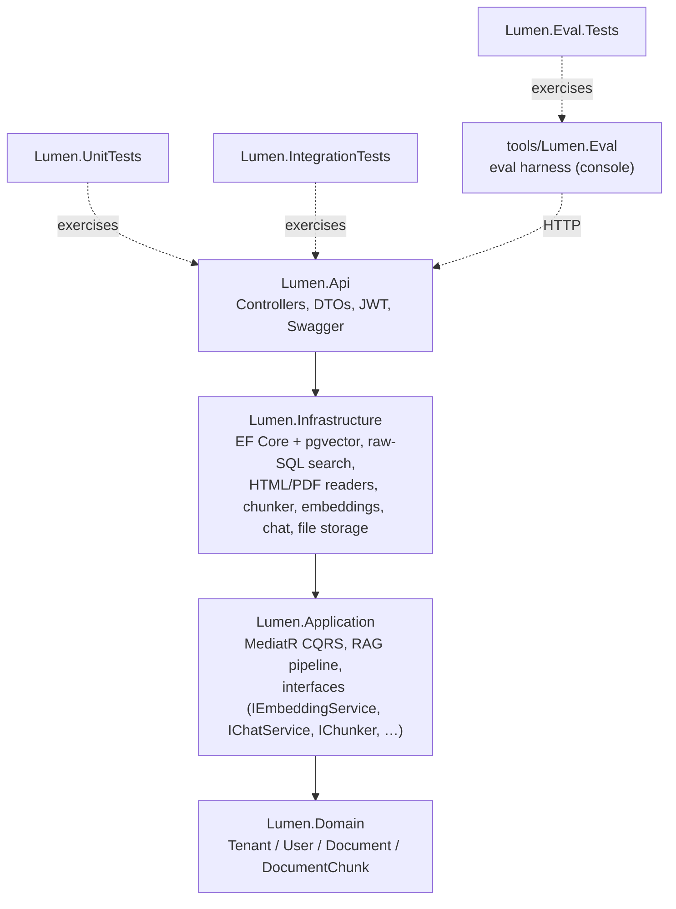
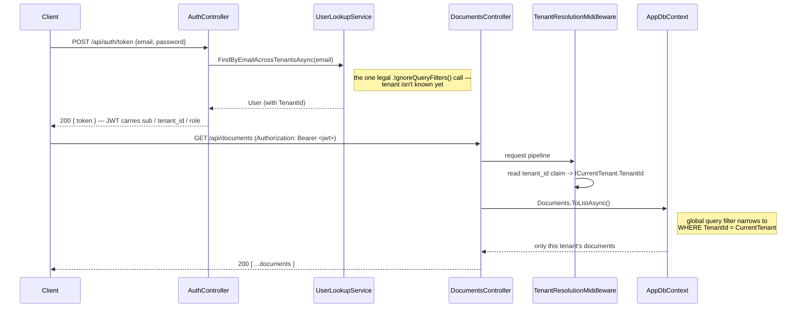
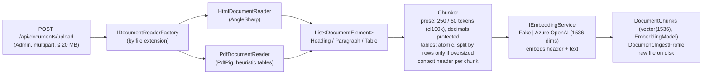
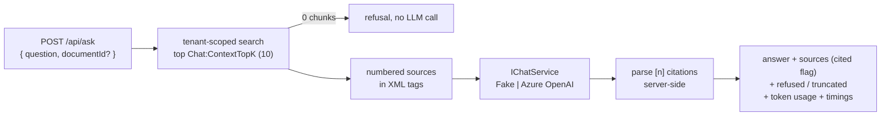
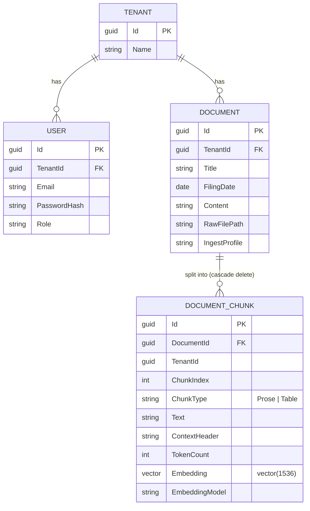

# Lumen — Multi-tenant RAG & MCP server on .NET

An ASP.NET Core service that ingests documents, indexes them for vector search in PostgreSQL (pgvector), answers questions with cited sources, and (next stage) exposes retrieval as an MCP server. Multi-tenant end to end: each tenant's data is isolated down to the raw SQL layer, not just the ORM.

The corpus is SEC EDGAR filings (10-K / 10-Q), one company per tenant. It is messy, table-heavy HTML, picked on purpose as a stress test for parsing and chunking. Every retrieval change was measured with a custom eval harness before it was kept or dropped.

## Results

30 questions with known answers over 4 filings (Apple and JPMorgan, 10-K + 10-Q), written from the source documents before any tuning. Answers are generated by `gpt-4o`. Numbers are scored in code, prose answers are judged by `gpt-5-mini` (a different model family, so the model never grades itself).

| | Baseline | Final | |
|---|---|---|---|
| Answer accuracy | 70 % | **87 %** | |
| False answers (answered instead of refusing) | 0 % | **0 %** | includes 4 unanswerable questions and 2 cross-tenant traps |
| False refusals | 33 % | 13 % | |
| Retrieval hit@5 / hit@10 | 71 % / 75 % | 83 % / **92 %** | |
| Retrieval MRR | 0.590 | 0.633 | |
| Answer latency p50 | 924 ms | 948 ms | |

Holdout set (6 questions, run once on the final configuration): 4/6, 0 false answers. With n = 30 the overall accuracy gain (7 questions gained, 2 lost) is not statistically significant (McNemar p = 0.18). The one step with a significant retrieval gain was a chunking bug fix (MRR p = 0.0085, see below). Raw runs are in [`tools/Lumen.Eval/runs/`](tools/Lumen.Eval/runs/).

## What's interesting here

- **Tenant isolation proven on raw SQL, with a negative control.** The vector query is the one query EF Core's global filter can't reach. A test seeds identical chunk text into two tenants and shows one tenant's search never returns the other's rows. A paired control runs the same SQL without the tenant predicate and shows it *does* leak, so the isolation comes from the predicate, not the table. 11 isolation tests at 5 levels: EF Core, HTTP, vector SQL, hybrid SQL and `/api/ask`.
- **The metrics lied, and the harness caught it.** The first baseline was computed on a corpus chunked under two different configs, and the settings endpoint truthfully reported only the current one. Anchor-based labels flagged the mismatch. The fix: every document now stores the chunking profile it was ingested with, and the harness refuses to run on a mismatched corpus.
- **Hybrid search rejected on evidence.** Postgres full-text search + vector, fused with RRF in a single tenant-scoped SQL statement: accuracy 70 % → 70 %, 3 questions gained, 3 lost (p = 1.0). The built-in `ts_rank_cd` has no IDF, so prose full of common words outranked the table holding the actual number.
- **A one-regex fix beat every "smart" change.** `$10.7 billion` was being stored as `$10. 7 billion` in 4 % of chunks. The cause was the sentence splitter inside the chunker, not the HTML reader. Protecting decimals during splitting was the only step with a statistically significant retrieval gain.
- **The biggest win was the simplest knob.** Retrieval found the right chunk in the top 10 far more often than in the top 5, so passing 10 sources to the model instead of 5 lifted accuracy 70 % → 83 %, 4 questions gained and 0 lost.

The full reasoning, alternatives and numbers behind each choice are in [`DECISIONS.md`](DECISIONS.md).

## Architecture

Onion Architecture: four layers, two test projects, plus the eval harness as a separate console tool that talks to the API over HTTP. Dependencies point strictly inward.



`Lumen.Domain` has zero external dependencies. `Lumen.Api` is the only layer that knows about ASP.NET Core/HTTP. AI providers, parsers and pgvector stay behind Application-layer interfaces in `Lumen.Infrastructure`.

### Multi-tenancy

A `TenantId` discriminator column plus an EF Core global query filter run through the whole stack:

- Every tenant-owned entity is transparently scoped to the caller's tenant on every query.
- Every new row is unconditionally stamped with the caller's `TenantId` on save.

There is one deliberate exception: looking up a user by email during login, before their tenant is known. It is a single, explicitly documented call site.



The vector search is the one query the filter cannot reach. `ORDER BY embedding <=> @query LIMIT k` doesn't compose in LINQ, so it is hand-written SQL that carries the tenant predicate explicitly. In hybrid mode the predicate appears in every CTE.

### Ingestion



- **Upload is synchronous and all-or-nothing.** Every chunk is embedded before anything is written. If the embedding provider fails (503), nothing is left behind: no document row, no chunks, no raw file.
- **Tables are never cut mid-row.** Each table is its own chunk and is split by rows only when it exceeds the token budget.
- **Each chunk gets a context header** such as `Apple 10-K (filed 2025-09-27) — Gross Margin`. It is stored separately and prepended only for embedding, so a bare table of numbers still carries its document, period and section.
- **Data remembers how it was written.** Every chunk records the embedding model that produced its vector (search filters on it), and every document records its ingest profile, e.g. `chunk=250/60;hdr=v1;merge=0;dec=v1`.

### Question answering



The model is told to answer only from the sources, cite them as `[n]`, and otherwise reply with a fixed refusal sentence. Citations are parsed and validated on the server. There is deliberately no similarity-distance threshold: thresholds don't transfer between embedding models and break with rank-fusion scores. Across all 15 full eval runs the model never answered a question it should have refused.

### Data model



## Evaluation

`tools/Lumen.Eval` is a console harness that drives the running API:

- **Two modes.** `retrieval` calls only `/api/search` and costs nothing. `full` calls `/api/ask` and scores the answers.
- **Labels survive re-chunking.** Each question lists verbatim *anchor* phrases from the filing instead of chunk ids, so the same eval set works across chunking experiments. Anchors that match no chunk are flagged as unlabelable.
- **Scoring.** Numbers are compared in code: sign-aware, so `(1,234)` and `-$1,234` are negative but a list bullet is not. Prose answers go to a binary LLM judge on a different deployment; the harness refuses to run if the judge is the same deployment as the answering model. Refusals are checked via the `refused` flag.
- **Metrics.** hit@1/3/5/10, MRR, accuracy, false-answer and false-refusal rates, latency, token usage, by question category.
- **Comparing runs.** `compare` runs an exact McNemar test on per-question flips and a paired randomization test on MRR.
- **Guard rails.** The harness exits 1 if any document's ingest profile differs from the server's config, and exits 2 on any cross-tenant leak.
- **Reproducibility.** Every run saves `run.json` (server settings, prompt hash, eval-set hash, git commit, corpus) and per-question `results.jsonl`.

Each change was measured on its own, one step at a time:

| Step | Change | Accuracy | hit@10 | MRR | Outcome |
|---|---|---|---|---|---|
| b0 | Vector search (baseline) | 70 % | 75 % | 0.590 | |
| b1 | + Hybrid search (FTS + RRF) | 70 % | 67 % | 0.550 | **Rejected**: 3:3 flips, p = 1.0 |
| b2 | + Context headers | 67 % | 92 % | 0.490 | **Kept**: recall in the top 10 |
| b3 | + Merge chunks ≤ 20 tokens | 67 % | 83 % | 0.490 | **Rejected**: 1:1 flips |
| b4 | + Protect decimals | 70 % | 92 % | 0.572 | **Kept**: MRR p = 0.0085 |
| b5 | + Max 3 chunks per document | 63 % | 88 % | 0.558 | **Rejected**: MRR worse, p = 0.033 |
| E4 | 10 sources to the model instead of 5 | 83 % | — | — | **Kept**: 4:0 flips |
| E5 | Temperature 0 / 0.2 / 0.6, 3 repeats each | 87 % each | — | — | No effect: 0 % verdict flips |
| **Final** | Vector + headers + decimals, 10 sources | **87 %** | **92 %** | **0.633** | |

Retrieval columns come from `retrieval` runs (top 10). Accuracy comes from `full` runs with 5 sources, except E4, E5 and Final with 10. Known remaining gaps: split tables don't repeat their header row, 10-K vs 10-Q comparisons need two chunks from two filings, and 30 questions is too few for significance.

## API

| Method | Route | Role | Purpose |
|---|---|---|---|
| `POST` | `/api/auth/token` | — | Log in, receive a JWT (`sub`, `tenant_id`, `role`) |
| `GET` | `/api/documents` | Admin, Member | List the tenant's documents with their ingest profile (`?includeContent=true` adds the extracted text) |
| `GET` | `/api/documents/{id}` | Admin, Member | One document |
| `GET` | `/api/documents/{id}/chunks` | Admin, Member | Its chunks (text, type, token count) |
| `POST` | `/api/documents/upload` | Admin | Upload an HTML/PDF filing: parse → chunk → embed → store |
| `DELETE` | `/api/documents/{id}` | Admin | Remove the document, its chunks and vectors, and the raw file |
| `POST` | `/api/search` | Admin, Member | Top-k chunks of the caller's tenant: `{ query, topK ≤ 50, documentId? }` |
| `POST` | `/api/ask` | Admin, Member | Answer a question from the tenant's documents, with `[n]` citations |
| `GET` | `/api/settings` | Admin | Effective non-secret config: models, chunking, search mode, ingest profile, prompt hash |

Another tenant's document returns 404, not 403: the global filter makes the row invisible, and a 403 would reveal that the id exists elsewhere.

## Configuration

Defaults in `src/Lumen.Api/appsettings.json` are the measured final configuration.

| Key | Default | |
|---|---|---|
| `Chunking:MaxTokensPerChunk` / `OverlapTokens` | 250 / 60 | |
| `Chunking:ContextHeaders` | `true` | |
| `Chunking:ProtectDecimals` | `true` | |
| `Chunking:MergeBelowTokens` | 0 (off) | |
| `Search:Mode` | `Vector` | `Hybrid` available, see `Search:RrfK`, `Candidates`, weights |
| `Search:MaxChunksPerDocument` | `null` (off) | |
| `Chat:ContextTopK` | 10 | sources passed to the model |
| `Chat:Temperature` | 0.2 | also `TopP`, `ReasoningEffort`, `MaxOutputTokens` |
| `Embeddings:Provider` / `Chat:Provider` | `Fake` | or `AzureOpenAI` |

Changing any `Chunking` setting changes the ingest profile, so delete and re-upload the documents. `Search` and `Chat` settings need only a restart.

## Implementation notes

- **Auth:** self-issued JWT, with no ASP.NET Core Identity and no external IdP. Roles are `Admin` (can ingest) and `Member` (query only).
- **CQRS:** MediatR, with a Repository + UnitOfWork pair over one shared scoped `AppDbContext`.
- **AI providers:** `Microsoft.Extensions.AI` (`IEmbeddingGenerator`, `IChatClient`) over the plain `OpenAI` client against Azure OpenAI's v1 API, with either an API key or Microsoft Entra ID. No `Azure.AI.OpenAI` package. The default `Fake` providers are deterministic and need no network, so the project builds, runs and tests with no Azure account.
- **Search:** exact (non-ANN) cosine search. About 300 ms over ~5,000 chunks, so no HNSW index yet.
- **Errors:** global exception handling via `IExceptionHandler` maps domain exceptions to `ProblemDetails`. An AI-provider failure returns 503.
- **Seed data:** in Development only, two tenants (Acme, Globex), each with an admin user and a sample document.
- **Tests:** 339 passing (193 unit, 77 eval harness, 69 integration against a real Postgres container), including a characterization test on a real Apple 10-K.

## Tech stack

- [PostgreSQL](https://www.postgresql.org/) + [pgvector](https://github.com/pgvector/pgvector): database, vector search and full-text search
- [EF Core](https://learn.microsoft.com/ef/core/) + [Npgsql](https://www.npgsql.org/efcore/) + [Pgvector.EntityFrameworkCore](https://github.com/pgvector/pgvector-dotnet): ORM, migrations, the `vector` type
- [Microsoft.Extensions.AI](https://learn.microsoft.com/dotnet/ai/microsoft-extensions-ai) + [OpenAI .NET](https://github.com/openai/openai-dotnet): embedding and chat abstractions and the Azure OpenAI (v1 API) client; [Azure.Identity](https://learn.microsoft.com/dotnet/api/overview/azure/identity-readme) for Entra ID
- [AngleSharp](https://anglesharp.github.io/): HTML parsing
- [PdfPig](https://github.com/UglyToad/PdfPig): PDF parsing
- [Semantic Kernel `TextChunker`](https://learn.microsoft.com/semantic-kernel/) + [Microsoft.ML.Tokenizers](https://www.nuget.org/packages/Microsoft.ML.Tokenizers) (cl100k): prose splitting and token counting
- [MediatR](https://github.com/jbogard/MediatR): CQRS commands and queries
- [AutoMapper](https://automapper.org/): Domain ↔ Entity ↔ Dto mapping
- [Microsoft.AspNetCore.Authentication.JwtBearer](https://learn.microsoft.com/aspnet/core/security/authentication/jwt-authn) + [`PasswordHasher<T>`](https://learn.microsoft.com/dotnet/api/microsoft.aspnetcore.identity.passwordhasher-1): JWT auth and password hashing
- [NLog](https://nlog-project.org/): logging (console + rolling file)
- [Swashbuckle](https://github.com/domaindrivendev/Swashbuckle.AspNetCore): Swagger/OpenAPI UI
- [xUnit](https://xunit.net/) + [Moq](https://github.com/devlooped/moq): unit tests
- [Testcontainers.PostgreSql](https://dotnet.testcontainers.org/modules/postgresql/): integration tests against a real `pgvector/pgvector:pg17` container

.NET 10. Exact versions live in each project's `.csproj`.

## Getting started

**Run:**

```bash
docker compose up -d # pgvector/pgvector:pg17, pulled on first run
dotnet run --project src/Lumen.Api
```

Open the printed Swagger URL and log in with a seeded user: `admin@acme.test` or `admin@globex.test`, password `Passw0rd!`. Upload a filing with `POST /api/documents/upload` (HTML from [SEC EDGAR](https://www.sec.gov/edgar/search/)), then query it with `POST /api/search` or `POST /api/ask`.

With the default `Fake` providers everything runs offline, but fake embeddings only match byte-identical text and the fake chat client returns a canned answer. They show the pipeline working, not real rankings.

**Switch to Azure OpenAI.** Keep settings in user-secrets, never in a tracked file:

```bash
cd src/Lumen.Api
dotnet user-secrets set "Embeddings:Provider" "AzureOpenAI"
dotnet user-secrets set "Embeddings:Endpoint" "https://<resource>.openai.azure.com/openai/v1/"
dotnet user-secrets set "Embeddings:Deployment" "<embedding deployment>"
dotnet user-secrets set "Embeddings:ApiKey" "<key>"   # or omit to use Microsoft Entra ID
# same keys under Chat:* for the answering model
```

After switching embeddings, recreate the database (`docker compose down -v && docker compose up -d`) and re-upload: vectors from different embedding models must never share a ranking. Switching chat needs no reset.

**Run the eval.** Upload the filings into the two tenants (Acme: Apple, Globex: JPMorgan), put the judge's key in `tools/Lumen.Eval/appsettings.Local.json` (gitignored) or the `LUMEN_EVAL_Judge__ApiKey` environment variable, then:

```bash
cd tools/Lumen.Eval
dotnet run -- run --mode retrieval --label my-run      # or --mode full, add --repeat N or --holdout
dotnet run -- compare runs/<runA> runs/<runB>
```

**Test:**

```bash
dotnet test
```

Integration tests spin up a real PostgreSQL container via Testcontainers, so Docker must be running. If they fail with `DockerUnavailableException`, your Docker Engine's reported API version may not match what Testcontainers negotiates by default:

```bash
DOCKER_API_VERSION=1.43 dotnet test
```

(match your own `docker version --format '{{.Server.APIVersion}}'`).

## Roadmap

1. ✅ Skeleton: Onion Architecture, multi-tenancy via `TenantId`
2. ✅ Ingest & chunking: HTML/PDF parsing, table-aware chunking
3. ✅ Embeddings + storage: Azure OpenAI + pgvector, exact tenant-scoped vector search
4. ✅ RAG endpoint: retrieval, generation with citations, eval-driven tuning
5. MCP server: search and documents exposed as MCP tools over HTTP, verified with MCP Inspector and Claude Code
6. Deploy: Azure App Service, managed identity, health checks
7. Polish: demo GIF, screenshots, one-command `docker compose up`
