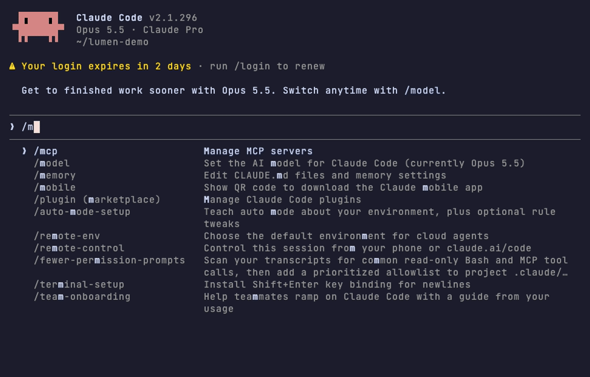
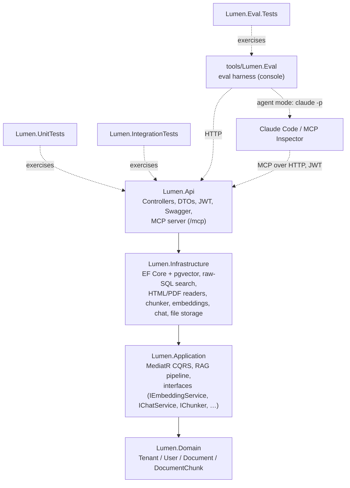
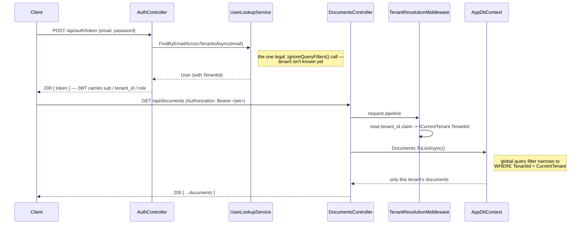
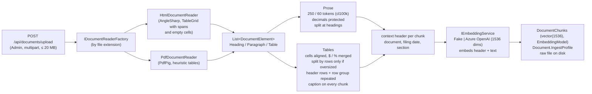
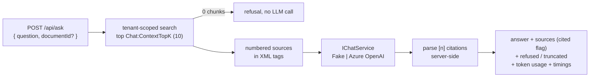
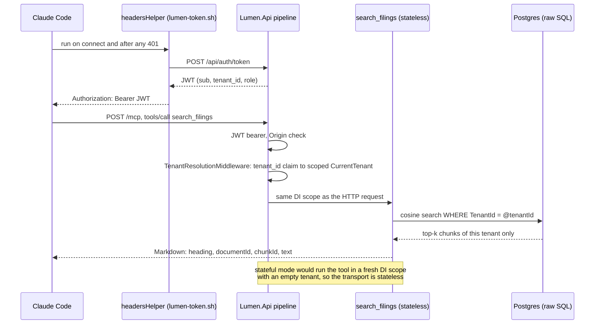
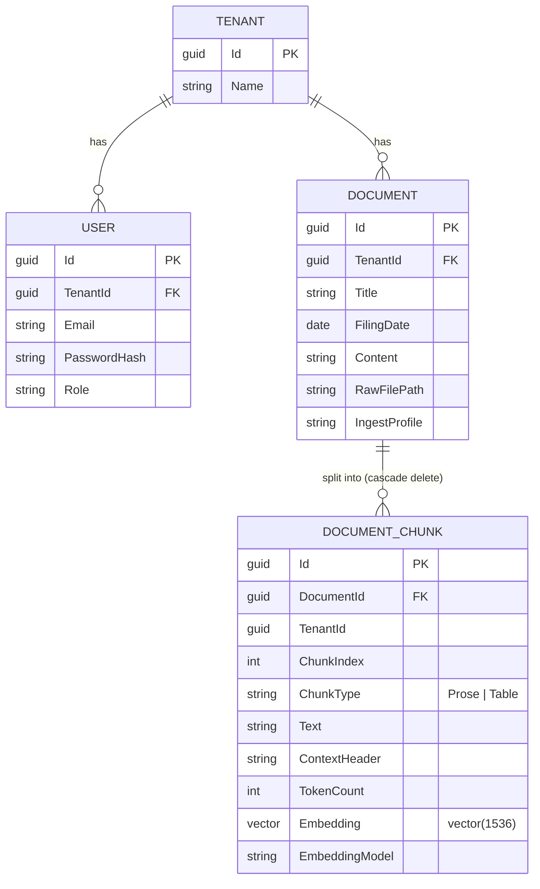
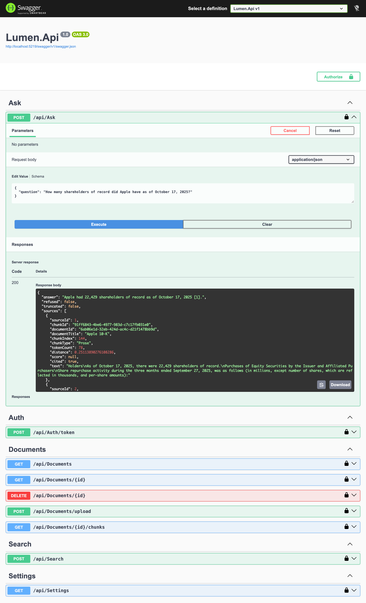
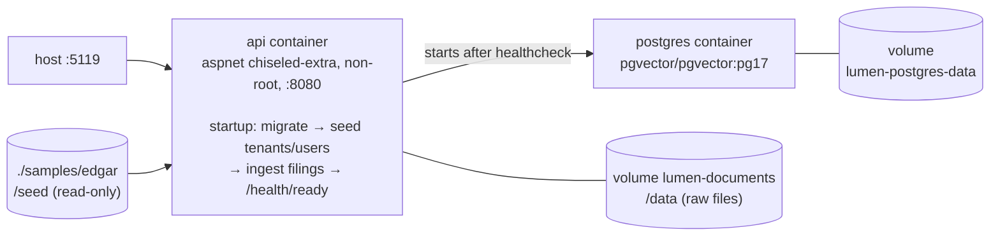

# Lumen — Multi-tenant RAG & MCP server on .NET

An ASP.NET Core service that ingests documents, indexes them for vector search in PostgreSQL (pgvector), answers questions with cited sources, and exposes retrieval as an MCP server that Claude Code can use. Multi-tenant end to end: each tenant's data is isolated down to the raw SQL layer, not just the ORM.

The corpus is SEC EDGAR filings (10-K / 10-Q), one company per tenant. It is messy, table-heavy HTML, picked on purpose as a stress test for parsing and chunking. Every retrieval change was measured with a custom eval harness before it was kept or dropped.



*Claude Code connected to Lumen over MCP as the Acme tenant (Apple's filings), on Azure OpenAI embeddings. The second question asks about JPMorgan, whose filings belong to another tenant: the search runs but only Apple's passages come back, so the agent can't answer.*

## Results

Measured on 4 real filings (Apple and JPMorgan, 10-K + 10-Q) with a question set written from the source documents before any tuning. Answers are generated by `gpt-4o`. Numbers are scored in code, prose answers are judged by `gpt-5-mini` (a different model family, so the model never grades itself).

**Current defaults** (`appsettings.json`), on the extended set: 35 questions, the original 30 plus 5 whose answer sits in the continuation of a split table (retrieval metrics over the 29 that carry retrieval labels):

| | Before table-aware chunking | Current defaults | |
|---|---|---|---|
| Answer accuracy | 77 % | **80 %** | |
| False answers (answered instead of refusing) | 0 % | **0 %** | includes unanswerable questions and cross-tenant traps |
| Retrieval hit@1 / hit@3 / hit@10 | 45 % / 52 % / 76 % | 48 % / **62 %** / 76 % | |
| Retrieval MRR | 0.524 | **0.565** | |

**How it got there.** On the original 30-question set, the Stage 4 retrieval and context work took accuracy from 70 % to 87 % (hit@10 75 % → 92 %, MRR 0.590 → 0.633, false answers 0 % throughout, answer latency p50 ~0.95 s). Stage 6B then extended the set with harder table questions, which is why its baseline (77 %) is lower than Stage 4's final number: the two sets are different and their percentages are not comparable.

Holdout set (6 questions, never used for tuning): 4/6, 0 false answers, both at the end of Stage 4 and on the current defaults. None of the gains is statistically significant on its own at this sample size (Stage 4: 7 gained / 2 lost, McNemar p = 0.18; Stage 6B: 2 gained / 1 lost, p = 1.0). The one step with a significant retrieval gain was a chunking bug fix (MRR p = 0.0085, see below). Raw runs are in [`tools/Lumen.Eval/runs/`](tools/Lumen.Eval/runs/).

## What's interesting here

- **Tenant isolation proven on raw SQL, with a negative control.** The vector query is the one query EF Core's global filter can't reach. A test seeds identical chunk text into two tenants and shows one tenant's search never returns the other's rows. A paired control runs the same SQL without the tenant predicate and shows it *does* leak, so the isolation comes from the predicate, not the table. 17 isolation tests in 9 classes at 6 levels: EF Core, HTTP, vector SQL, hybrid SQL, `/api/ask` and MCP.
- **The metrics lied, and the harness caught it.** The first baseline was computed on a corpus chunked under two different configs, and the settings endpoint truthfully reported only the current one. Anchor-based labels flagged the mismatch. The fix: every document now stores the chunking profile it was ingested with, and the harness refuses to run on a mismatched corpus.
- **Hybrid search rejected on evidence.** Postgres full-text search + vector, fused with RRF in a single tenant-scoped SQL statement: on the original 30-question set, accuracy 70 % → 70 %, 3 questions gained, 3 lost (p = 1.0). The built-in `ts_rank_cd` has no IDF, so prose full of common words outranked the table holding the actual number.
- **A one-regex fix beat every "smart" change.** `$10.7 billion` was being stored as `$10. 7 billion` in 4 % of chunks. The cause was the sentence splitter inside the chunker, not the HTML reader. Protecting decimals during splitting was the only step with a statistically significant retrieval gain.
- **Split tables keep their header, and the measurement caught a bug the unit tests didn't.** EDGAR HTML never uses `<th>`/`<thead>`, so Lumen detects a table's header from its cell grid (a prototype aligned the columns of 97.8–100 % of data tables in the four filings) and repeats it, plus the open row-group label and the table's caption, on every continuation chunk. That fixed the Stage 4 failure where a JPMorgan capital-ratio row arrived with no years and no "Standardized" label (accuracy 77 % → 80 %, hit@3 52 % → 62 %). The holdout then refused a question whose chunk had lost its caption: a first chunk over budget was being repacked without it. A log line counting repacks showed the scale (2 such chunks per JPMorgan filing, 63 with the key-value format); after the fix it is 0 on every filing.
- **Stateless MCP is an isolation requirement, not a scaling choice.** Only in stateless mode does an MCP tool run in the HTTP request's DI scope, where the tenant was resolved from the JWT. Switched to stateful, the tool saw an empty tenant: the isolation test's positive control ("tenant B finds its own document") failed, while a negative-only test still passed. Every MCP isolation test now checks both directions.
- **An agent with plain search matches the RAG pipeline.** Answering the original 30-question eval set through Claude Code + the MCP `search_filings` tool scored 87 %, the same as `/api/ask` (3 gained, 3 lost), at ~9× the cost and ~8× the latency. So MCP exposes search only. The first agent run said 40 % — the client's own user settings had switched it to Russian, which the number scorer couldn't read.
- **The biggest win was the simplest knob.** Retrieval found the right chunk in the top 10 far more often than in the top 5, so passing 10 sources to the model instead of 5 lifted accuracy 70 % → 83 % on the original 30-question set, 4 questions gained and 0 lost.

The full reasoning, alternatives and numbers behind each choice are in [`DECISIONS.md`](DECISIONS.md).

## Architecture

Onion Architecture: four layers, two test projects, plus the eval harness as a separate console tool that talks to the API over HTTP. Dependencies point strictly inward.



`Lumen.Domain` has zero external dependencies. `Lumen.Api` is the only layer that knows about ASP.NET Core/HTTP. AI providers, parsers and pgvector stay behind Application-layer interfaces in `Lumen.Infrastructure`.

### Multi-tenancy

A `TenantId` discriminator column plus an EF Core global query filter run through the whole stack:

- Every tenant-owned entity is transparently scoped to the caller's tenant on every query.
- Every new row is unconditionally stamped with the caller's `TenantId` on save.

There is one deliberate exception: looking up a user by email during login, before their tenant is known. It is a single, explicitly documented call site.



The vector search is the one query the filter cannot reach. `ORDER BY embedding <=> @query LIMIT k` doesn't compose in LINQ, so it is hand-written SQL that carries the tenant predicate explicitly. In hybrid mode the predicate appears in every CTE.

### Ingestion



- **Upload is synchronous and all-or-nothing.** Every chunk is embedded before anything is written. If the embedding provider fails (503), nothing is left behind: no document row, no chunks, no raw file.
- **Tables are never cut mid-row, and their pieces stay readable.** Each table is its own chunk, split by rows only when it exceeds the token budget. Tables are rendered from their cell grid (`$` and `%` merged into the number, empty cells kept so columns don't shift). Every continuation chunk repeats the header rows and the open row-group label, and every chunk of a table carries the caption sentence from the paragraph above it.
- **Each chunk gets a context header** such as `Apple 10-K (filed 2025-09-27) — Gross Margin`. It is stored separately and prepended only for embedding, so a bare table of numbers still carries its document, period and section.
- **Data remembers how it was written.** Every chunk records the embedding model that produced its vector (search filters on it), and every document records its ingest profile, e.g. `chunk=250/60;hdr=v1;merge=0;dec=v1;cells=v2;thdr=v2;tcap=v2`.

### Question answering



The model is told to answer only from the sources, cite them as `[n]`, and otherwise reply with a fixed refusal sentence. Citations are parsed and validated on the server. There is deliberately no similarity-distance threshold: thresholds don't transfer between embedding models and break with rank-fusion scores. Across all 15 full eval runs the model never answered a question it should have refused.

### MCP request flow



### Data model



## Evaluation

`tools/Lumen.Eval` is a console harness that drives the running API:

- **Two modes.** `retrieval` calls only `/api/search` and costs nothing. `full` calls `/api/ask` and scores the answers.
- **Labels survive re-chunking.** Each question lists verbatim *anchor* phrases from the filing instead of chunk ids, so the same eval set works across chunking experiments. Anchors that match no chunk are flagged as unlabelable.
- **Scoring.** Numbers are compared in code: sign-aware, so `(1,234)` and `-$1,234` are negative but a list bullet is not. Prose answers go to a binary LLM judge on a different deployment; the harness refuses to run if the judge is the same deployment as the answering model. Refusals are checked via the `refused` flag.
- **Metrics.** hit@1/3/5/10, MRR, accuracy, false-answer and false-refusal rates, latency, token usage, by question category.
- **Comparing runs.** `compare` runs an exact McNemar test on per-question flips and a paired randomization test on MRR.
- **Guard rails.** The harness exits 1 if any document's ingest profile differs from the server's config, and exits 2 on any cross-tenant leak.
- **Reproducibility.** Every run saves `run.json` (server settings, prompt hash, eval-set hash, git commit, corpus) and per-question `results.jsonl`.

**Stage 4 ladder** (original 30-question set). Each change was measured on its own, one step at a time:

| Step | Change | Accuracy | hit@10 | MRR | Outcome |
|---|---|---|---|---|---|
| b0 | Vector search (baseline) | 70 % | 75 % | 0.590 | |
| b1 | + Hybrid search (FTS + RRF) | 70 % | 67 % | 0.550 | **Rejected**: 3:3 flips, p = 1.0 |
| b2 | + Context headers | 67 % | 92 % | 0.490 | **Kept**: recall in the top 10 |
| b3 | + Merge chunks ≤ 20 tokens | 67 % | 83 % | 0.490 | **Rejected**: 1:1 flips |
| b4 | + Protect decimals | 70 % | 92 % | 0.572 | **Kept**: MRR p = 0.0085 |
| b5 | + Max 3 chunks per document | 63 % | 88 % | 0.558 | **Rejected**: MRR worse, p = 0.033 |
| E4 | 10 sources to the model instead of 5 | 83 % | — | — | **Kept**: 4:0 flips |
| E5 | Temperature 0 / 0.2 / 0.6, 3 repeats each | 87 % each | — | — | No effect: 0 % verdict flips |
| **Final** | Vector + headers + decimals, 10 sources | **87 %** | **92 %** | **0.633** | |

**Stage 6B ladder** (extended 35-question set: the original 30 plus 5 split-table questions; not comparable with the table above). Each step adds one table switch on top of the Stage 4 final configuration:

| Step | Change | Accuracy | hit@3 | MRR | JPM 10-K / 10-Q chunks | Outcome |
|---|---|---|---|---|---|---|
| t0 | Stage 4 final (baseline) | 77 % | 52 % | 0.524 | 2,523 / 1,358 | |
| t1 | + Tables rendered from the cell grid | 71 % | 52 % | 0.511 | 2,494 / 1,328 | Kept as a prerequisite: 0:2, rank swaps between headerless tables |
| t2 | + Repeated header rows + captions | **80 %** | **62 %** | **0.565** | 2,596 / 1,444 | **Kept**: 3:0 vs t1, 2:1 vs t0 (p = 1.0) |
| t3 | + Key-value cell format | 77 % | 59 % | 0.561 | 3,166 / 2,280 | **Rejected**: 0:1, +58 % 10-Q chunks |
| t4 | t2 + context header in the prompt | 80 % | = t2 | 0.565 | = t2 | **Rejected**: 0:0, +~250 input tokens per question |

A third mode, `agent`, answers each question through `claude -p` with Lumen's MCP tools (built-in tools off, the user's own Claude Code settings and hooks off) and scores the answer the same way:

| Run | Answering path | Accuracy | False answers | Cost / run | Latency p50 |
|---|---|---|---|---|---|
| Stage 4 Final (above) | `/api/ask`, gpt-4o, 10 sources | 87 % | 0 % | ~$0.15 | 0.95 s |
| M1 | Claude Code + `search_filings` / `list_filings` | 87 % (3:3, p = 1.0) | 33 % ("not disclosed, but…") | $1.37 | 8.1 s |
| M2 | M1 + `get_chunk_context` | 87 % (0:0 vs M1) | 33 % | $1.44 | 7.7 s |

In M2 the agent never called the neighbour-chunk tool, so it stays off.

Stage 4 retrieval columns come from `retrieval` runs (top 10); accuracy comes from `full` runs with 5 sources, except E4, E5 and Final with 10. All Stage 6B runs use 10 sources. The agent runs (M1, M2) used the original 30-question set. Known remaining gaps: text tables whose first numeric row comes late get a wrong header, which is not repeated; tables whose header sits in a separate `<table>` above them get none; a one-row continuation with a long repeated header can drop out of the top 10; 10-K vs 10-Q comparisons need two chunks from two filings; and the sets are too small for significance.

## API



The screenshot comes from a local run on Azure OpenAI (`gpt-4o`, `text-embedding-3-small`), logged in as the Acme admin. To re-take it, install the tooling once (`cd tools/media && npm install && npx playwright install chromium`), start `tools/media/demo-server.sh` (or point `LUMEN_URL` at another running API, e.g. `LUMEN_URL=http://localhost:5119`), then run `node tools/media/swagger-screenshot.mjs`.

| Method | Route | Role | Purpose |
|---|---|---|---|
| `POST` | `/api/auth/token` | — | Log in, receive a JWT (`sub`, `tenant_id`, `role`) |
| `GET` | `/api/documents` | Admin, Member | List the tenant's documents with their ingest profile (`?includeContent=true` adds the extracted text) |
| `GET` | `/api/documents/{id}` | Admin, Member | One document |
| `GET` | `/api/documents/{id}/chunks` | Admin, Member | Its chunks (text, type, token count) |
| `POST` | `/api/documents/upload` | Admin | Upload an HTML/PDF filing: parse → chunk → embed → store |
| `DELETE` | `/api/documents/{id}` | Admin | Remove the document, its chunks and vectors, and the raw file |
| `POST` | `/api/search` | Admin, Member | Top-k chunks of the caller's tenant: `{ query, topK ≤ 50, documentId? }` |
| `POST` | `/api/ask` | Admin, Member | Answer a question from the tenant's documents, with `[n]` citations |
| `GET` | `/api/settings` | Admin | Effective non-secret config: models, chunking, search mode, ingest profile, prompt hash |
| `POST` | `/mcp` | Admin, Member | MCP server (Streamable HTTP, stateless): `search_filings`, `list_filings`; see [Connect from Claude Code](#connect-from-claude-code-mcp) |

Another tenant's document returns 404, not 403: the global filter makes the row invisible, and a 403 would reveal that the id exists elsewhere.

## Configuration

Defaults in `src/Lumen.Api/appsettings.json` are the measured final configuration.

| Key | Default | |
|---|---|---|
| `Chunking:MaxTokensPerChunk` / `OverlapTokens` | 250 / 60 | |
| `Chunking:ContextHeaders` | `true` | |
| `Chunking:ProtectDecimals` | `true` | |
| `Chunking:MergeBelowTokens` | 0 (off) | |
| `Chunking:TableCells` | `true` | render tables from their cell grid (merged `$`/`%`, empty cells kept) |
| `Chunking:TableHeaders` | `true` | repeat header rows and the row-group label on continuation chunks; requires `TableCells` |
| `Chunking:TableCaptions` | `true` | copy the caption sentence onto every chunk of a table |
| `Chunking:TableFormat` | `Pipe` | or `KeyValue` (`column: value` pairs); requires `TableCells` |
| `Search:Mode` | `Vector` | `Hybrid` available, see `Search:RrfK`, `Candidates`, weights |
| `Search:MaxChunksPerDocument` | `null` (off) | |
| `Chat:ContextTopK` | 10 | sources passed to the model |
| `Chat:Temperature` | 0.2 | also `TopP`, `ReasoningEffort`, `MaxOutputTokens` |
| `Chat:SourceContextHeader` | `false` | add the chunk's context header to each `<source>` in the `/api/ask` prompt |
| `Embeddings:Provider` / `Chat:Provider` | `Fake` | or `AzureOpenAI` |
| `Mcp:ContextTool` | `false` | exposes `get_chunk_context` (neighbouring chunks) |
| `Mcp:AllowedOrigins` | `[]` | allowed `Origin` values on `/mcp`; Development adds the MCP Inspector |
| `Database:MigrateOnStartup` | `false` | apply EF migrations at startup (on in Development and in compose) |
| `Database:SeedDemoData` | `false` | seed demo tenants/users (on in Development and in compose) |
| `Demo:FilingsPath` | empty | folder with `manifest.json` and filings to ingest on startup (compose: `/seed`) |
| `Swagger:Enabled` | Development only | serve Swagger UI |
| `Logs:FileMinLevel` | `Info` | `Off` disables the rolling file (compose logs to stdout only) |

Changing any `Chunking` setting changes the ingest profile, so delete and re-upload the documents. `Search`, `Chat` and `Mcp` settings need only a restart.

## Implementation notes

- **Auth:** self-issued JWT, with no ASP.NET Core Identity and no external IdP. Roles are `Admin` (can ingest) and `Member` (query only).
- **CQRS:** MediatR, with a Repository + UnitOfWork pair over one shared scoped `AppDbContext`.
- **AI providers:** `Microsoft.Extensions.AI` (`IEmbeddingGenerator`, `IChatClient`) over the plain `OpenAI` client against Azure OpenAI's v1 API, with either an API key or Microsoft Entra ID. No `Azure.AI.OpenAI` package. The default `Fake` providers are deterministic and need no network, so the project builds, runs and tests with no Azure account.
- **Search:** exact (non-ANN) cosine search. About 300 ms over ~5,000 chunks, so no HNSW index yet.
- **Errors:** global exception handling via `IExceptionHandler` maps domain exceptions to `ProblemDetails`. An AI-provider failure returns 503.
- **Seed data:** behind `Database:SeedDemoData` (on in Development and in compose): two tenants (Acme, Globex), each with an admin user. With `Demo:FilingsPath` set (compose mounts `samples/edgar/` read-only at `/seed`), the four filings in its `manifest.json` are ingested too, skipping titles that already exist.
- **MCP:** `ModelContextProtocol.AspNetCore` 2.2.0, stateless Streamable HTTP at `/mcp` behind the same JWT bearer scheme; tools call the Application layer through MediatR and return Markdown; an `Origin` check guards `/mcp`; a call-tool filter turns domain exceptions into actionable tool errors without leaking details.
- **Tests:** 513 passing (305 unit, 106 eval harness, 102 integration against a real Postgres container), including a characterization test on a real Apple 10-K.

## Tech stack

- [PostgreSQL](https://www.postgresql.org/) + [pgvector](https://github.com/pgvector/pgvector): database, vector search and full-text search
- [EF Core](https://learn.microsoft.com/ef/core/) + [Npgsql](https://www.npgsql.org/efcore/) + [Pgvector.EntityFrameworkCore](https://github.com/pgvector/pgvector-dotnet): ORM, migrations, the `vector` type
- [Microsoft.Extensions.AI](https://learn.microsoft.com/dotnet/ai/microsoft-extensions-ai) + [OpenAI .NET](https://github.com/openai/openai-dotnet): embedding and chat abstractions and the Azure OpenAI (v1 API) client; [Azure.Identity](https://learn.microsoft.com/dotnet/api/overview/azure/identity-readme) for Entra ID
- [AngleSharp](https://anglesharp.github.io/): HTML parsing
- [PdfPig](https://github.com/UglyToad/PdfPig): PDF parsing
- [Semantic Kernel `TextChunker`](https://learn.microsoft.com/semantic-kernel/) + [Microsoft.ML.Tokenizers](https://www.nuget.org/packages/Microsoft.ML.Tokenizers) (cl100k): prose splitting and token counting
- [MediatR](https://github.com/jbogard/MediatR): CQRS commands and queries
- [AutoMapper](https://automapper.org/): Domain ↔ Entity ↔ Dto mapping
- [Microsoft.AspNetCore.Authentication.JwtBearer](https://learn.microsoft.com/aspnet/core/security/authentication/jwt-authn) + [`PasswordHasher<T>`](https://learn.microsoft.com/dotnet/api/microsoft.aspnetcore.identity.passwordhasher-1): JWT auth and password hashing
- [NLog](https://nlog-project.org/): logging (console + rolling file)
- [Swashbuckle](https://github.com/domaindrivendev/Swashbuckle.AspNetCore): Swagger/OpenAPI UI
- [xUnit](https://xunit.net/) + [Moq](https://github.com/devlooped/moq): unit tests
- [Testcontainers.PostgreSql](https://dotnet.testcontainers.org/modules/postgresql/): integration tests against a real `pgvector/pgvector:pg17` container

.NET 10. Exact versions live in each project's `.csproj`.

## Getting started

### Run with Docker

Needs only Docker. The stack is Postgres (pgvector) plus the API, with four EDGAR filings seeded on first start.

```bash
cp .env.example .env     # then fill JWT_SECRET (required): openssl rand -hex 32
docker compose up --build
```



- Swagger: <http://localhost:5119/swagger> · readiness: <http://localhost:5119/health/ready> · MCP: `http://localhost:5119/mcp` (see [Connect from Claude Code](#connect-from-claude-code-mcp)).
- Log in with `admin@acme.test` or `admin@globex.test`, password `Passw0rd!`.
- On first start the API applies the migrations and seeds four filings from `samples/edgar/`: Apple 10-K and 10-Q for Acme Corp, Morgan 10-K and 10-Q for Globex Inc. The default providers are `Fake`, so nothing calls the network and the rankings are not meaningful; the point is a working pipeline. Measured on an Apple Silicon laptop: the image is 202 MB, and a cold start to `/health/ready` takes about 7.5 s including migrations and seeding all four filings (4,650 chunks). A restart on an already seeded database takes about 1.2 s.
- Compose sets `AllowedHosts=localhost;127.0.0.1`, so call the API via `localhost` (a LAN IP gets 400 unless you change `AllowedHosts`).
- If `JWT_SECRET` is missing, the `api` container crash-loops and `docker compose ps` still shows it as `Up`. Check `docker compose logs api` for the `Jwt:Secret` error.
- If the local Postgres volume already holds a corpus from `dotnet run` (for example with Azure embeddings), start the demo from a clean database with `docker compose down -v` first, because seeding skips titles that already exist. Careful: `down -v` deletes the local database and the stored raw files.
- **Azure OpenAI instead of `Fake`:** set `EMBEDDINGS_PROVIDER=AzureOpenAI` (and the `EMBEDDINGS_*` values) or `CHAT_PROVIDER=AzureOpenAI` (and the `CHAT_*` values) in `.env`. Changing the embeddings provider requires `docker compose down -v` so that vectors from two models never share a table; changing chat does not.
- **Smoke test:** `tools/compose-smoke.sh` builds the image, starts an isolated stack (project `lumen-smoke`, ports 55119 and 55432, always `Fake` providers), checks health, seeded documents, search, ask and MCP `tools/list` for both tenants, restarts it to confirm persistence and that seeding is skipped, then removes its own volumes. It does not touch your regular compose project.

### Run from source

```bash
docker compose up -d postgres # pgvector/pgvector:pg17, pulled on first run
dotnet run --project src/Lumen.Api
```

Use `docker compose up -d postgres`, not plain `docker compose up -d`: the latter also starts the containerized API on port 5119, which collides with `dotnet run`.

Open the printed Swagger URL and log in with a seeded user: `admin@acme.test` or `admin@globex.test`, password `Passw0rd!`. Upload a filing with `POST /api/documents/upload` (HTML from [SEC EDGAR](https://www.sec.gov/edgar/search/)), then query it with `POST /api/search` or `POST /api/ask`.

With the default `Fake` providers everything runs offline, but fake embeddings only match byte-identical text and the fake chat client returns a canned answer. They show the pipeline working, not real rankings.

**Switch to Azure OpenAI.** Keep settings in user-secrets, never in a tracked file:

```bash
cd src/Lumen.Api
dotnet user-secrets set "Embeddings:Provider" "AzureOpenAI"
dotnet user-secrets set "Embeddings:Endpoint" "https://<resource>.openai.azure.com/openai/v1/"
dotnet user-secrets set "Embeddings:Deployment" "<embedding deployment>"
dotnet user-secrets set "Embeddings:ApiKey" "<key>"   # or omit to use Microsoft Entra ID
# same keys under Chat:* for the answering model
```

After switching embeddings, recreate the database (`docker compose down -v && docker compose up -d postgres`) and re-upload: vectors from different embedding models must never share a ranking. Switching chat needs no reset.

**Run the eval.** Upload the filings into the two tenants (Acme: Apple, Globex: JPMorgan), put the judge's key in `tools/Lumen.Eval/appsettings.Local.json` (gitignored) or the `LUMEN_EVAL_Judge__ApiKey` environment variable, then:

```bash
cd tools/Lumen.Eval
dotnet run -- run --mode retrieval --label my-run      # or --mode full, add --repeat N or --holdout
dotnet run -- compare runs/<runA> runs/<runB>
```

### Connect from Claude Code (MCP)

Lumen exposes its tenant-scoped search as an MCP server at `http://localhost:5119/mcp`. It uses the same JWT as the REST API: the token's `tenant_id` decides which company's filings the tools can see, so logging in as `admin@acme.test` gives Apple's filings and `admin@globex.test` gives JPMorgan's. There is no OAuth server: the client sends `Authorization: Bearer <JWT>` itself. Tokens live 60 minutes.

**Quick start: a static token** (good for a short session):

```bash
TOKEN=$(curl -s -X POST http://localhost:5119/api/auth/token -H 'Content-Type: application/json' \
  -d '{"email":"admin@acme.test","password":"Passw0rd!"}' | jq -r .token)
claude mcp add --transport http lumen http://localhost:5119/mcp --header "Authorization: Bearer $TOKEN"
```

**Recommended: a token helper** that logs in on every connection and again whenever the token expires. Claude Code runs the command in `headersHelper` and uses the header it prints (`tools/mcp/lumen-token.sh` needs `curl` and `jq`):

```bash
# run from the repository root
claude mcp add-json lumen --scope local "{
  \"type\": \"http\",
  \"url\": \"http://localhost:5119/mcp\",
  \"headersHelper\": \"LUMEN_EMAIL=admin@acme.test LUMEN_PASSWORD='Passw0rd!' $PWD/tools/mcp/lumen-token.sh\"
}"
```

Then start `claude` in the repository folder and accept the workspace trust prompt. Claude Code only runs a `headersHelper` in a trusted folder. Run `/mcp`: `lumen` should be connected with two tools. `tools/mcp/mcp.example.json` shows the same configuration as a `.mcp.json` file, with the credentials taken from `LUMEN_EMAIL` / `LUMEN_PASSWORD` in the environment. To switch companies, register a second server (for example `lumen-globex`) with `admin@globex.test`.

Try asking (as Acme):

- *How many shareholders of record did Apple have as of October 17, 2025?* (22,429)
- *What were Apple's Wearables, Home and Accessories net sales in fiscal 2025, and why did they change?* ($35,686 million, down 4 %, lower Accessories and Wearables sales)
- *How much did Apple's Mac net sales grow in the third quarter of fiscal 2026?* ($10,352 million vs $8,046 million, up 29 %)
- *What revenue guidance did Apple give for fiscal 2027?* (not in the filings; the model should say so)

| Tool | Arguments | Returns |
|---|---|---|
| `search_filings` | `query`, `topK` (1–20, default 10), `documentId` (optional) | Matching passages as Markdown: filing and section heading, `documentId`, `chunkId`, text |
| `list_filings` | — | The tenant's filings with filing dates and `documentId`s |

Troubleshooting:

- **`Failed to connect` / "Dynamic Client Registration rejected (404)":** the client got a 401 and fell back to OAuth discovery, which Lumen deliberately doesn't implement. Usually the header never reached the server: the helper didn't run (workspace not trusted), the token expired (static header), or `Bearer ` is missing.
- **403:** the request carried an `Origin` header that is not in `Mcp:AllowedOrigins`.
- **MCP Inspector** works the same way: `npx @modelcontextprotocol/inspector`, transport Streamable HTTP, URL `http://localhost:5119/mcp`, header `Authorization: Bearer <JWT>`. A CLI check: `npx @modelcontextprotocol/inspector --cli http://localhost:5119/mcp --transport http --header "Authorization: Bearer $TOKEN" --method tools/list`.

The demo GIF at the top is reproducible: `tools/media/demo-server.sh` starts a separate API on port 5219 with its own `lumen_demo` database (Azure settings from user-secrets), and `DEMO=<dir> vhs tools/media/mcp-demo.tape` records the session (instructions at the top of the tape file).

Claude Desktop and claude.ai are not supported: their custom connectors need OAuth 2.1, which is a deliberate non-goal for now (see `DECISIONS.md`).

**Test:**

```bash
dotnet test
```

Integration tests spin up a real PostgreSQL container via Testcontainers, so Docker must be running. If they fail with `DockerUnavailableException`, your Docker Engine's reported API version may not match what Testcontainers negotiates by default:

```bash
DOCKER_API_VERSION=1.43 dotnet test
```

(match your own `docker version --format '{{.Server.APIVersion}}'`).

## How I'd deploy to Azure

Not deployed yet; this is the plan, with the facts it rests on taken from Microsoft Learn.

- **Compute:** Azure App Service for Containers running the same image. Set `WEBSITES_PORT=8080` so App Service knows the container port.
- **Health check:** configure the path `/health/ready`. App Service pings every instance once a minute; an instance that fails 10 pings (`WEBSITE_HEALTHCHECK_MAXPINGFAILURES`, 2 to 10) is removed from the load balancer. A ping fails on a non-2xx answer, a redirect or a 1-minute timeout, and the path must allow anonymous access, which `/health/ready` does. The check only gives full benefit with 2 or more instances.
- **Database:** Azure Database for PostgreSQL Flexible Server. Allow-list the extension by adding `vector` to the `azure.extensions` server parameter (the name is `vector`, not `pgvector`); the Lumen migration then runs `CREATE EXTENSION vector`. Flexible Server ships pgvector 0.8.2 (local Docker has a newer one); Lumen only uses `vector(1536)`, the `<=>` operator and exact scans, which that version supports.
- **Secrets:** App Settings as [Key Vault references](https://learn.microsoft.com/azure/app-service/app-service-key-vault-references) (`@Microsoft.KeyVault(SecretUri=...)`) for `Jwt__Secret` and `ConnectionStrings__Default`, resolved by the app's system-assigned identity with the Key Vault Secrets User role. An unresolved reference reaches the app as a literal string, so the fail-fast `Jwt:Secret` check (at least 32 bytes) catches a misconfigured vault.
- **Azure OpenAI without keys:** leave `Embeddings:ApiKey` and `Chat:ApiKey` empty. The existing code path then uses `DefaultAzureCredential` (the managed identity) against the v1 API, so only a role assignment on the Azure OpenAI resource is needed.
- **Raw files:** the container filesystem is ephemeral, so replace `LocalFileStorage` with a Blob Storage implementation of `IFileStorage` (the seam already exists), authenticated with the managed identity.
- **Migrations:** run an EF migration bundle as a deploy step, the production path Microsoft recommends. The `Database:MigrateOnStartup` flag stays acceptable for one or two instances, because Npgsql serializes concurrent migrators with a table lock, but then the app's database user needs DDL rights.

## Roadmap

1. ✅ Skeleton: Onion Architecture, multi-tenancy via `TenantId`
2. ✅ Ingest & chunking: HTML/PDF parsing, table-aware chunking
3. ✅ Embeddings + storage: Azure OpenAI + pgvector, exact tenant-scoped vector search
4. ✅ RAG endpoint: retrieval, generation with citations, eval-driven tuning
5. ✅ MCP server: tenant-scoped search as MCP tools over HTTP, verified with MCP Inspector and Claude Code, measured against the RAG endpoint
6. ✅ Run anywhere + tables: Dockerfile and `docker compose up` with health endpoints and seeded demo filings; table-aware chunking that repeats headers and captions. The real Azure App Service deploy was deliberately skipped (see "How I'd deploy to Azure")
7. ✅ Polish: demo GIF, Swagger screenshot, diagrams, DECISIONS.md pass
