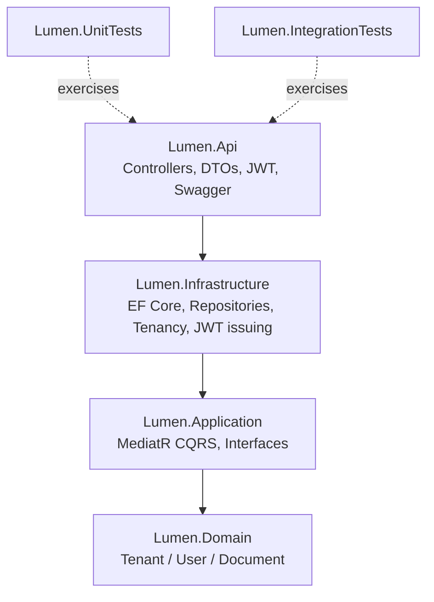
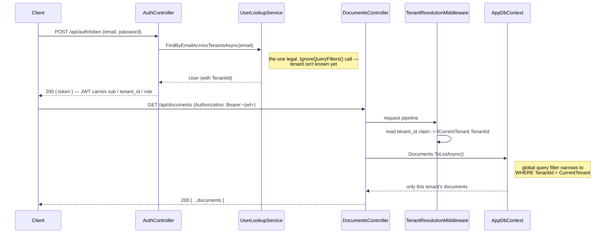
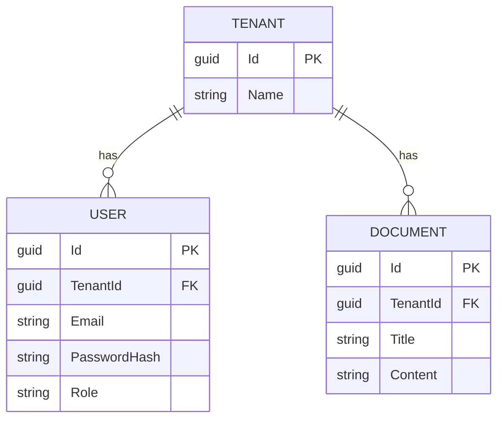

# Lumen — Multi-tenant RAG & MCP server on .NET

ASP.NET Core service that ingests documents, indexes them with vector
search in PostgreSQL (pgvector), and exposes retrieval as an MCP
server. Multi-tenant end to end — each tenant's data is isolated down
to the raw SQL layer, not just the ORM.

Pet project, work in progress. Full write-up, diagram, and demo GIF
land at the end — see roadmap below.

## Structure

This section reflects Stage 1 (Skeleton) as built. It'll be extended as later stages land.

### Architecture

Onion Architecture, four layers plus two test projects, dependencies pointing strictly inward:



`Lumen.Domain` has zero external dependencies. `Lumen.Api` is the only layer aware of ASP.NET Core/HTTP specifics.

Multi-tenancy runs through the whole stack via a `TenantId` discriminator column and an EF Core global query filter — every tenant-owned entity is transparently scoped to the caller's tenant on every query, and every new row is unconditionally stamped with the caller's `TenantId` on save. The one deliberate exception (looking up a user by email during login, before their tenant is known) is a single, explicitly documented call site — see [`DECISIONS.md`](DECISIONS.md).





### Implementation

- Multi-tenancy: `TenantId` discriminator + EF Core global query filter on every tenant-owned entity; `AppDbContext.SaveChanges` unconditionally stamps `TenantId` from the ambient tenant on new rows, so a caller can never set it themselves.
- Self-issued JWT auth — no ASP.NET Core Identity, no external IdP. Claims: `sub`, `tenant_id`, `role`.
- CQRS via MediatR for the `Document` vertical slice (create/list/get-by-id), backed by a Repository + UnitOfWork pair over one shared scoped `AppDbContext`.
- Global exception handling via `IExceptionHandler` mapping domain exceptions to `ProblemDetails` responses.
- Seed data on startup (Development only): two tenants with one admin user and one document each, so the API is usable out of the box.
- 23/23 tests passing (11 unit, 12 integration) — including two independent tenant-isolation tests: one at the EF Core level, one a full HTTP round-trip through `WebApplicationFactory` with real issued JWTs.
- **Stage 3 addition:** `POST /api/search` — embeds the query text (Azure OpenAI, or a deterministic no-network fake for local dev) and runs a hand-written cosine-distance query against pgvector-stored chunk embeddings, tenant-scoped by hand in raw SQL rather than through EF Core's global filter (a non-composable vector query can't use it). A `DECISIONS.md` entry follows once hands-on testing confirms the numbers (see `.research/stage-3/user-checklist.md`).

### Dependencies

- [PostgreSQL](https://www.postgresql.org/) — database
- [EF Core](https://learn.microsoft.com/ef/core/) + [Npgsql](https://www.npgsql.org/efcore/) — ORM, migrations
- [MediatR](https://github.com/jbogard/MediatR) — CQRS commands/queries
- [AutoMapper](https://automapper.org/) — Domain ↔ Entity ↔ Dto mapping
- [Microsoft.AspNetCore.Authentication.JwtBearer](https://learn.microsoft.com/aspnet/core/security/authentication/jwt-authn) + [`PasswordHasher<T>`](https://learn.microsoft.com/dotnet/api/microsoft.aspnetcore.identity.passwordhasher-1) — JWT auth, password hashing
- [NLog](https://nlog-project.org/) — logging (console + rolling file)
- [Swashbuckle](https://github.com/domaindrivendev/Swashbuckle.AspNetCore) — Swagger/OpenAPI UI
- [xUnit](https://xunit.net/) + [Moq](https://github.com/devlooped/moq) — unit tests
- [Testcontainers.PostgreSql](https://dotnet.testcontainers.org/modules/postgresql/) — integration tests against a real Postgres container

Exact versions live in each project's `.csproj`.

### Getting started

**Run:**

```bash
docker compose up -d # runs pgvector/pgvector:pg17, pulled on first run
dotnet run --project src/Lumen.Api
```

Open the printed Swagger URL. Log in with a seeded user (`DbSeeder`): `admin@acme.test` / `admin@globex.test`, password `Passw0rd!`.

**Test:**

```bash
dotnet test
```

Integration tests spin up a real PostgreSQL container via Testcontainers — Docker must be running. If it fails with `DockerUnavailableException`, your Docker Engine's reported API version may not match what Testcontainers negotiates by default:

```bash
DOCKER_API_VERSION=1.43 dotnet test
```

(match your own `docker version --format '{{.Server.APIVersion}}'`).

## What's coming

1. ✅ Skeleton — Onion Architecture, multi-tenancy via `TenantId`
2. Ingest & chunking — document parsing pipeline
3. Embeddings + storage — Azure OpenAI + pgvector
4. RAG endpoint — retrieval, generation, eval-driven tuning
5. MCP server — search/documents exposed as MCP tools
6. Deploy — Azure App Service, managed identity
7. Polish — diagram, demo, docker-compose

Design rationale and decisions live in [`DECISIONS.md`](DECISIONS.md).
