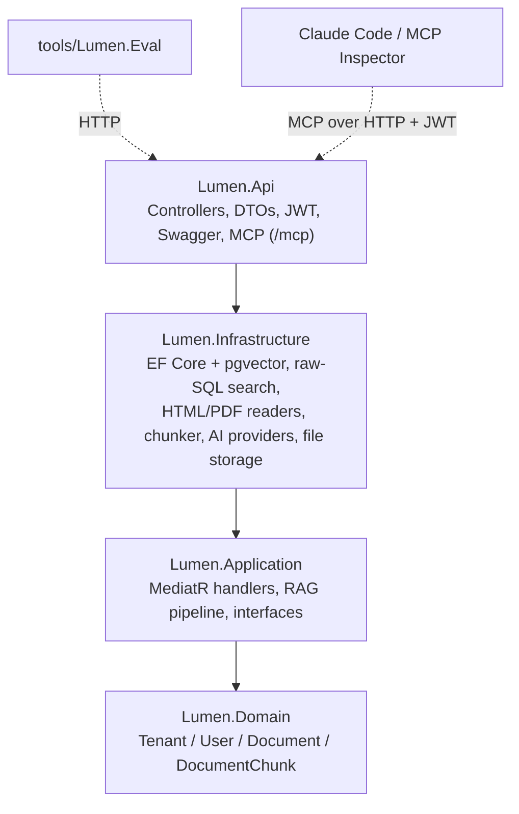
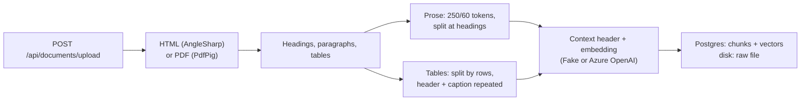

# Lumen

A multi-tenant RAG and MCP server on .NET. It ingests documents, stores their chunks as vectors in PostgreSQL (pgvector), answers questions with cited sources and exposes search as MCP tools that Claude Code can call. Each tenant sees only its own data, including in the one query that bypasses the ORM.

I used SEC EDGAR filings (10-K and 10-Q) as the corpus, one company per tenant. The HTML is messy and full of tables, which makes it a good stress test for parsing and chunking. I measured every retrieval change with an eval harness before keeping or dropping it.


*Claude Code is connected over MCP as the Acme tenant (Apple's filings). The second question is about JPMorgan, whose filings belong to another tenant, so the search only returns Apple passages and the agent can't answer.*

## Results

Four real filings (Apple and JPMorgan, 10-K and 10-Q). I wrote the questions from the filings before tuning anything. `gpt-4o` answers. Numbers are checked in code and prose answers are graded by `gpt-5-mini`, so the model never grades its own answers.

| | Baseline | Current defaults |
|---|---|---|
| Answer accuracy | 77 % | **80 %** |
| False answers (answered when it should have refused) | 0 % | **0 %** |
| Retrieval hit@3 / hit@10 | 52 % / 76 % | **62 %** / 76 % |
| Retrieval MRR | 0.524 | **0.565** |

This is the extended set of 35 questions, including 5 whose answer sits in the second half of a split table. On the original 30 questions, the Stage 4 tuning took accuracy from 70 % to 87 %. The two sets are different, so their percentages can't be compared directly. A 6-question holdout that I never tuned against scores 4/6 with 0 false answers. None of the gains is statistically significant at this sample size. Raw runs are in [`tools/Lumen.Eval/runs/`](tools/Lumen.Eval/runs/).

## Highlights

- **Tenant isolation is tested on the raw SQL.** EF Core's global filter can't reach the vector query. A test puts identical text into two tenants and checks that neither tenant's search returns the other's rows. A control runs the same SQL without the tenant predicate and does see both, which shows the predicate is what isolates the data. There are 17 isolation tests across EF Core, HTTP, vector SQL, hybrid SQL, `/api/ask` and MCP.
- **The cheapest change gave the biggest win.** Retrieval found the right chunk in the top 10 much more often than in the top 5. Giving the model 10 sources instead of 5 raised accuracy from 70 % to 83 % (4 questions gained, none lost).
- **A one-regex fix was the only significant gain.** The sentence splitter turned `$10.7 billion` into `$10. 7 billion` in 4 % of chunks. Protecting decimals improved MRR with p = 0.0085.
- **Hybrid search was rejected.** Postgres full-text search fused with vectors via RRF gained 3 questions and lost 3. `ts_rank_cd` has no IDF, so prose full of common words outranked the table that held the number.
- **Split tables keep their header.** EDGAR HTML never uses `<th>`, so Lumen finds the header from the cell grid and repeats it, along with the row group and caption, on every continuation chunk (accuracy 77 % → 80 %).
- **The MCP transport has to be stateless.** In stateful mode a tool runs outside the request's DI scope and sees no tenant at all. The isolation test caught this only because it also checks that a tenant can find its own data.
- **An agent with plain search matches the RAG pipeline.** Claude Code with the `search_filings` tool scored 87 %, the same as `/api/ask`, at about 9× the cost and 8× the latency. So MCP exposes search only.

The reasoning and numbers behind each choice are in [`DECISIONS.md`](DECISIONS.md).

## Architecture

The solution uses Onion Architecture: four layers, with dependencies pointing inward. The eval harness is a separate console app that calls the API over HTTP.



**Multi-tenancy.** Every tenant-owned table has a `TenantId` column. An EF Core global query filter scopes every query to the caller's tenant, which comes from the `tenant_id` claim in the JWT, and every new row is stamped with it on save. Login is the one place that ignores the filter, because the tenant isn't known until the user is found. The vector search is hand-written SQL, so it carries the tenant predicate itself. Another tenant's document returns 404, not 403, so its id isn't revealed.

**Ingestion.**



Uploads are synchronous and all-or-nothing: every chunk is embedded before anything is saved, so a provider failure (503) leaves nothing behind. Each chunk records the embedding model that produced its vector, and each document records the chunking settings it was ingested with (its ingest profile). The eval harness refuses to run if those settings don't match the server's.

**Question answering.** `/api/ask` retrieves the top 10 chunks, passes them to the model as numbered sources and parses the `[n]` citations on the server. If nothing is retrieved, it refuses without calling the model. Otherwise the model must answer from the sources or reply with a fixed refusal sentence. Across 15 full eval runs it never answered a question it should have refused.

**MCP.** `/mcp` uses stateless Streamable HTTP behind the same JWT as the REST API. Claude Code gets the token from a small helper script, which runs again on any 401.

## Evaluation

`tools/Lumen.Eval` runs the eval set against a running API.

- `retrieval` mode calls `/api/search` only and costs nothing. `full` mode calls `/api/ask` and scores the answers. `agent` mode answers through `claude -p` with Lumen's MCP tools.
- Questions are labelled with exact phrases from the filing instead of chunk ids, so the labels still work after re-chunking.
- `compare` runs a McNemar test on per-question changes and a paired randomization test on MRR.
- Each run saves its settings, prompt hash, git commit and corpus to `run.json`, and per-question results to `results.jsonl`.

What I tried, one change at a time:

| Change | Result | Kept? |
|---|---|---|
| Context header on every chunk | hit@10 67 % → 92 % | Yes |
| Protect decimals during splitting | MRR 0.490 → 0.572, p = 0.0085 | Yes |
| 10 sources instead of 5 | accuracy 70 % → 83 %, 4:0 | Yes |
| Repeat table headers and captions | accuracy 77 % → 80 %, hit@3 52 % → 62 % | Yes |
| Hybrid search (FTS + RRF) | 3:3, p = 1.0 | No |
| Merge chunks ≤ 20 tokens | 1:1 | No |
| Max 3 chunks per document | accuracy 70 % → 63 %, MRR worse (p = 0.033) | No |
| Key-value table format | 0:1, +58 % chunks | No |
| Temperature 0 / 0.2 / 0.6 | 87 % at each | No effect |
| Claude Code + MCP search instead of `/api/ask` | 87 % vs 87 %, ~9× cost | Search only |

Known gaps: 10-K vs 10-Q comparisons, tables whose header sits in a separate table above them, and a sample too small for significance.

## API


| Method | Route | Role | Purpose |
|---|---|---|---|
| `POST` | `/api/auth/token` | — | Log in and get a JWT |
| `GET` | `/api/documents` | Admin, Member | List documents with their ingest profile |
| `GET` | `/api/documents/{id}` | Admin, Member | One document |
| `GET` | `/api/documents/{id}/chunks` | Admin, Member | Its chunks |
| `POST` | `/api/documents/upload` | Admin | Upload an HTML or PDF filing |
| `DELETE` | `/api/documents/{id}` | Admin | Delete a document, its chunks and its raw file |
| `POST` | `/api/search` | Admin, Member | Top-k chunks: `{ query, topK ≤ 50, documentId? }` |
| `POST` | `/api/ask` | Admin, Member | Answer with `[n]` citations |
| `GET` | `/api/settings` | Admin | Effective non-secret config and prompt hash |
| `POST` | `/mcp` | Admin, Member | MCP tools `search_filings` and `list_filings` |

## Configuration

The defaults in `src/Lumen.Api/appsettings.json` are the measured best configuration.

| Key | Default |
|---|---|
| `Chunking:MaxTokensPerChunk` / `OverlapTokens` | 250 / 60 |
| `Chunking:ContextHeaders`, `ProtectDecimals` | `true` |
| `Chunking:TableCells`, `TableHeaders`, `TableCaptions` | `true` |
| `Chunking:TableFormat` | `Pipe` (or `KeyValue`) |
| `Chunking:MergeBelowTokens` | 0 (off) |
| `Search:Mode` | `Vector` (or `Hybrid`) |
| `Chat:ContextTopK` / `Temperature` | 10 / 0.2 |
| `Embeddings:Provider`, `Chat:Provider` | `Fake` (or `AzureOpenAI`) |
| `Mcp:ContextTool` | `false` |
| `Database:MigrateOnStartup`, `SeedDemoData` | `false` (on in Development and compose) |

After changing any `Chunking` setting, delete and re-upload the documents. Other settings only need a restart.

## Tech stack

.NET 10, ASP.NET Core, EF Core + Npgsql, PostgreSQL + pgvector, Microsoft.Extensions.AI with the OpenAI client (Azure OpenAI v1 API), AngleSharp, PdfPig, Semantic Kernel `TextChunker`, MediatR, AutoMapper, NLog, xUnit, Moq, Testcontainers.

## Getting started

### Docker

```bash
cp .env.example .env     # set JWT_SECRET, e.g. openssl rand -hex 32
docker compose up --build
```

This starts Postgres and the API on <http://localhost:5119> (Swagger at `/swagger`) and loads four sample filings: Apple for `admin@acme.test`, JPMorgan for `admin@globex.test`. The password is `Passw0rd!`. The default `Fake` providers need no network, but their search results aren't meaningful. To use Azure OpenAI, set the `EMBEDDINGS_*` and `CHAT_*` values in `.env`.

If the API container keeps restarting, check `docker compose logs api`; it is usually a missing `JWT_SECRET`.

### From source

```bash
docker compose up -d postgres
dotnet run --project src/Lumen.Api
```

Keep Azure settings in user-secrets:

```bash
cd src/Lumen.Api
dotnet user-secrets set "Embeddings:Provider" "AzureOpenAI"
dotnet user-secrets set "Embeddings:Endpoint" "https://<resource>.openai.azure.com/openai/v1/"
dotnet user-secrets set "Embeddings:Deployment" "<deployment>"
dotnet user-secrets set "Embeddings:ApiKey" "<key>"   # omit to use Entra ID
# the same keys under Chat:* for the answering model
```

After switching embedding providers, reset the database (`docker compose down -v`) and re-upload, so vectors from two models never get mixed.

### Connect Claude Code

```bash
claude mcp add-json lumen --scope local "{
  \"type\": \"http\",
  \"url\": \"http://localhost:5119/mcp\",
  \"headersHelper\": \"LUMEN_EMAIL=admin@acme.test LUMEN_PASSWORD='Passw0rd!' $PWD/tools/mcp/lumen-token.sh\"
}"
```

Run `claude` from the repository root and accept the trust prompt (Claude Code only runs a `headersHelper` in a trusted folder). Then ask something like *How many shareholders of record did Apple have as of October 17, 2025?* (22,429).

If the connection fails with a "Dynamic Client Registration" 404, the token didn't reach the server and the client fell back to OAuth, which Lumen doesn't implement. Claude Desktop and claude.ai aren't supported for the same reason.

### Eval and tests

```bash
cd tools/Lumen.Eval
dotnet run -- run --mode retrieval --label my-run    # or --mode full
dotnet run -- compare runs/<runA> runs/<runB>
```

The judge's API key goes in `tools/Lumen.Eval/appsettings.Local.json` (gitignored) or `LUMEN_EVAL_Judge__ApiKey`.

`dotnet test` runs all 513 tests. Integration tests start Postgres in Docker via Testcontainers. If they fail with `DockerUnavailableException`, set `DOCKER_API_VERSION` to the value of `docker version --format '{{.Server.APIVersion}}'`.

## Deploying to Azure

I haven't deployed it yet. The plan:

- **App Service for Containers** with the same image, `WEBSITES_PORT=8080` and health check path `/health/ready`.
- **Azure Database for PostgreSQL Flexible Server**, with `vector` added to `azure.extensions`.
- **Key Vault references** for `Jwt__Secret` and the connection string, resolved through the app's managed identity.
- **Managed identity for Azure OpenAI**: leave the API keys empty and the existing code uses `DefaultAzureCredential`.
- **Blob Storage** for raw files behind the existing `IFileStorage` interface, since the container's disk doesn't persist.
- **An EF migration bundle** as a deploy step instead of migrating on startup.
