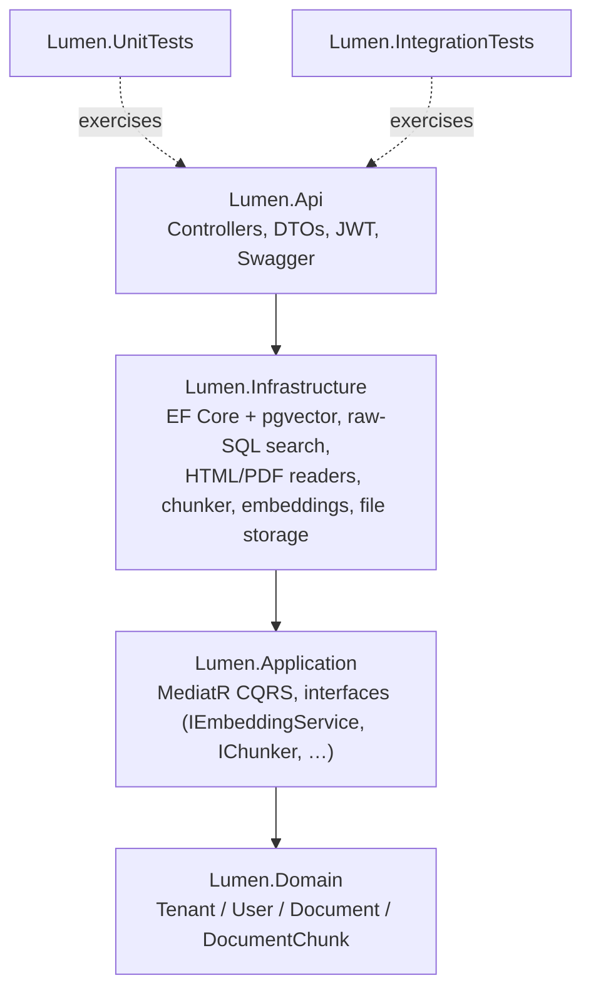
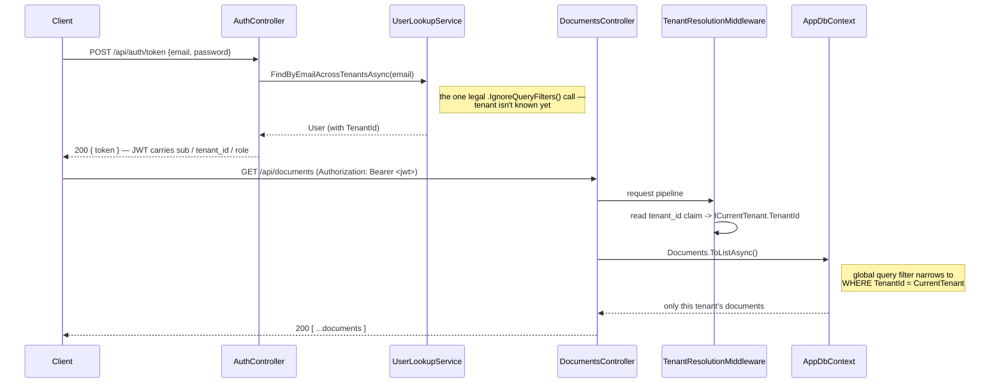
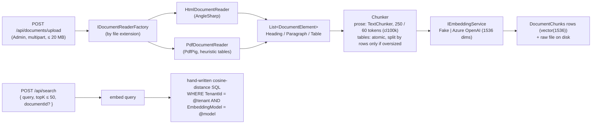
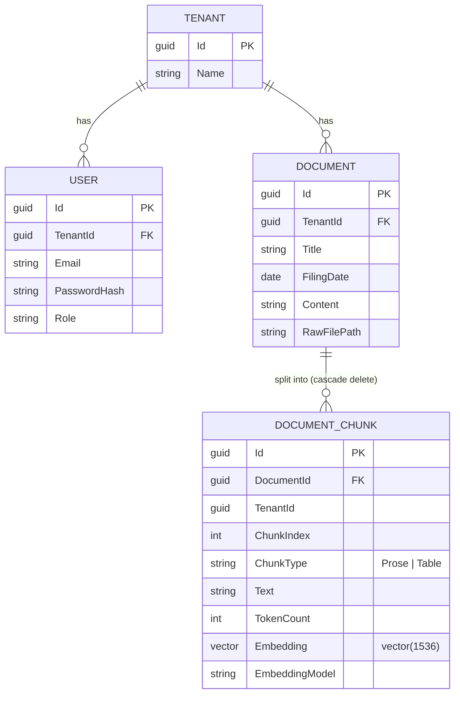

# Lumen — Multi-tenant RAG & MCP server on .NET

ASP.NET Core service that ingests documents, indexes them with vector
search in PostgreSQL (pgvector), and exposes retrieval as an MCP
server. Multi-tenant end to end — each tenant's data is isolated down
to the raw SQL layer, not just the ORM.

The test corpus is SEC EDGAR filings (10-K / 10-Q), one company per tenant: messy, table-heavy HTML that makes a deliberate stress test for parsing and chunking.

Pet project, work in progress. The full write-up, diagram and demo GIF come at the end (see the roadmap below).

## Structure

This section covers Stages 1–3 as built: skeleton, ingestion & chunking, embeddings & vector search. Later stages will extend it.

### Architecture

Onion Architecture: four layers plus two test projects, with dependencies pointing strictly inward.



`Lumen.Domain` has zero external dependencies. `Lumen.Api` is the only layer that knows about ASP.NET Core/HTTP. AI providers, parsers and pgvector all stay behind Application-layer interfaces in `Lumen.Infrastructure`.

### Multi-tenancy

A `TenantId` discriminator column plus an EF Core global query filter run through the whole stack:

- Every tenant-owned entity is transparently scoped to the caller's tenant on every query.
- Every new row is unconditionally stamped with the caller's `TenantId` on save.

There is one deliberate exception: looking up a user by email during login, before their tenant is known. It is a single, explicitly documented call site (see [`DECISIONS.md`](DECISIONS.md)).



The vector search is the one query EF Core's filter cannot reach. It is an `ORDER BY embedding <=> @query LIMIT k` statement, which LINQ can't compose over, so it is hand-written SQL that carries the tenant predicate explicitly. A dedicated integration test proves the isolation holds:

- the identical chunk text is seeded into two tenants, and one tenant's search never returns the other's rows;
- a negative control shows the table has no isolation of its own.

### Ingestion and search



- **Upload is synchronous and all-or-nothing.** Every chunk is embedded before anything is written. If the embedding provider fails (503), nothing is left behind: no document row, no chunks, no raw file.
- **Tables are never cut mid-row.** Each table is its own chunk and is split by rows only when it exceeds the token budget. On a real Apple 10-K (1.4 MB of HTML), 87 of 296 chunks are tables.
- **Every chunk records which embedding model produced its vector.** Search filters on that model, so vectors left over from a previous provider can't skew a ranking.

### Data model



### API

| Method | Route | Role | Purpose |
|---|---|---|---|
| `POST` | `/api/auth/token` | — | Log in, receive a JWT (`sub`, `tenant_id`, `role`) |
| `GET` | `/api/documents` | Admin, Member | List the tenant's documents (`?includeContent=true` adds the extracted text) |
| `GET` | `/api/documents/{id}` | Admin, Member | One document |
| `GET` | `/api/documents/{id}/chunks` | Admin, Member | Its chunks (text, type, token count) |
| `POST` | `/api/documents/upload` | Admin | Upload an HTML/PDF filing: parse → chunk → embed → store |
| `DELETE` | `/api/documents/{id}` | Admin | Remove the document, its chunks and vectors, and the raw file |
| `POST` | `/api/search` | Admin, Member | Top-k nearest chunks of the caller's tenant |

Another tenant's document returns 404, not 403: the global filter makes the row invisible, and a 403 would reveal that the id exists elsewhere.

### Implementation

- **Multi-tenancy:** a `TenantId` discriminator and an EF Core global query filter on every tenant-owned entity. `AppDbContext.SaveChanges` stamps `TenantId` from the ambient tenant, so a caller can never set it.
- **Auth:** self-issued JWT, with no ASP.NET Core Identity and no external IdP. Roles are `Admin` (can ingest) and `Member` (query only).
- **CQRS:** MediatR, with a Repository + UnitOfWork pair over one shared scoped `AppDbContext`.
- **Ingestion:**
  - extension-based readers emit a format-agnostic list of headings, paragraphs and tables;
  - a table-atomic chunker splits prose with Tiktoken `cl100k` token counts (250 tokens with 60 overlap by default, set in the `Chunking` config);
  - raw files are stored under `DocumentStorage:RootPath` as `{tenant-slug}_{TenantId}/{title-slug}_{DocumentId}.{ext}`.
- **Embeddings:** `IEmbeddingService` has two implementations, selected by `Embeddings:Provider`:
  - `Fake`: deterministic, hash-based, no network. It is the default, so the project builds, runs and tests with no Azure account.
  - `AzureOpenAI`: `Microsoft.Extensions.AI`'s `IEmbeddingGenerator` over the plain `OpenAI` client against Azure's v1 API, with either an API key or Microsoft Entra ID.
- **Storage and search:** PostgreSQL + pgvector with exact (non-ANN) search for now, and a `(TenantId, EmbeddingModel)` index.
- **Errors:** global exception handling via `IExceptionHandler` maps domain exceptions to `ProblemDetails`; an embedding-provider failure returns 503.
- **Seed data:** on startup in Development only, two tenants (Acme, Globex), each with an admin user and a sample document.
- **Tests:** 137/137 passing (94 unit, 43 integration). They include tenant-isolation tests at three levels: EF Core, full HTTP with real issued JWTs, and the raw vector SQL. A characterization test runs on a real Apple 10-K.

### Dependencies

- [PostgreSQL](https://www.postgresql.org/) + [pgvector](https://github.com/pgvector/pgvector): database and vector search
- [EF Core](https://learn.microsoft.com/ef/core/) + [Npgsql](https://www.npgsql.org/efcore/) + [Pgvector.EntityFrameworkCore](https://github.com/pgvector/pgvector-dotnet): ORM, migrations, the `vector` type
- [Microsoft.Extensions.AI](https://learn.microsoft.com/dotnet/ai/microsoft-extensions-ai) + [OpenAI .NET](https://github.com/openai/openai-dotnet): embedding abstraction and the Azure OpenAI (v1 API) client; [Azure.Identity](https://learn.microsoft.com/dotnet/api/overview/azure/identity-readme) for Entra ID
- [AngleSharp](https://anglesharp.github.io/): HTML parsing
- [PdfPig](https://github.com/UglyToad/PdfPig): PDF parsing
- [Semantic Kernel `TextChunker`](https://learn.microsoft.com/semantic-kernel/) + [Microsoft.ML.Tokenizers](https://www.nuget.org/packages/Microsoft.ML.Tokenizers) (cl100k): prose splitting and token counting
- [MediatR](https://github.com/jbogard/MediatR): CQRS commands and queries
- [AutoMapper](https://automapper.org/): Domain ↔ Entity ↔ Dto mapping
- [Microsoft.AspNetCore.Authentication.JwtBearer](https://learn.microsoft.com/aspnet/core/security/authentication/jwt-authn) + [`PasswordHasher<T>`](https://learn.microsoft.com/dotnet/api/microsoft.aspnetcore.identity.passwordhasher-1): JWT auth and password hashing
- [NLog](https://nlog-project.org/): logging (console + rolling file)
- [Swashbuckle](https://github.com/domaindrivendev/Swashbuckle.AspNetCore): Swagger/OpenAPI UI
- [xUnit](https://xunit.net/) + [Moq](https://github.com/devlooped/moq): unit tests
- [Testcontainers.PostgreSql](https://dotnet.testcontainers.org/modules/postgresql/): integration tests against a real `pgvector/pgvector:pg17` container

Exact versions live in each project's `.csproj`.

### Getting started

**Run:**

```bash
docker compose up -d # pgvector/pgvector:pg17, pulled on first run
dotnet run --project src/Lumen.Api
```

Open the printed Swagger URL and log in with a seeded user (`DbSeeder`): `admin@acme.test` or `admin@globex.test`, password `Passw0rd!`. Then upload a filing with `POST /api/documents/upload` and query it with `POST /api/search`.

By default embeddings use the `Fake` provider. It is deterministic and needs no network, but it only matches byte-identical text, so it shows the pipeline working rather than producing meaningful rankings.

**Switch embeddings to Azure OpenAI:** set the following (in `appsettings.Development.json` or as environment variables):

- `Embeddings:Provider=AzureOpenAI`
- `Embeddings:Endpoint=https://<resource>.openai.azure.com/openai/v1/`
- `Embeddings:Deployment=<deployment name>`
- `Embeddings:ApiKey=<key>`, or leave it empty to use Microsoft Entra ID

Then recreate the database (`docker compose down -v && docker compose up -d`) and re-upload your filings. Vectors from different embedding models must never share a ranking.

**Test:**

```bash
dotnet test
```

Integration tests spin up a real PostgreSQL container via Testcontainers, so Docker must be running. If they fail with `DockerUnavailableException`, your Docker Engine's reported API version may not match what Testcontainers negotiates by default:

```bash
DOCKER_API_VERSION=1.43 dotnet test
```

(match your own `docker version --format '{{.Server.APIVersion}}'`).

## What's coming

1. ✅ Skeleton: Onion Architecture, multi-tenancy via `TenantId`
2. ✅ Ingest & chunking: HTML/PDF parsing, table-aware chunking
3. ✅ Embeddings + storage: Azure OpenAI + pgvector, exact tenant-scoped vector search
4. RAG endpoint: retrieval, generation, eval-driven tuning (in progress)
5. MCP server: search and documents exposed as MCP tools
6. Deploy: Azure App Service, managed identity
7. Polish: diagram, demo, docker-compose

Design rationale and decisions, with the numbers behind them, live in [`DECISIONS.md`](DECISIONS.md).
